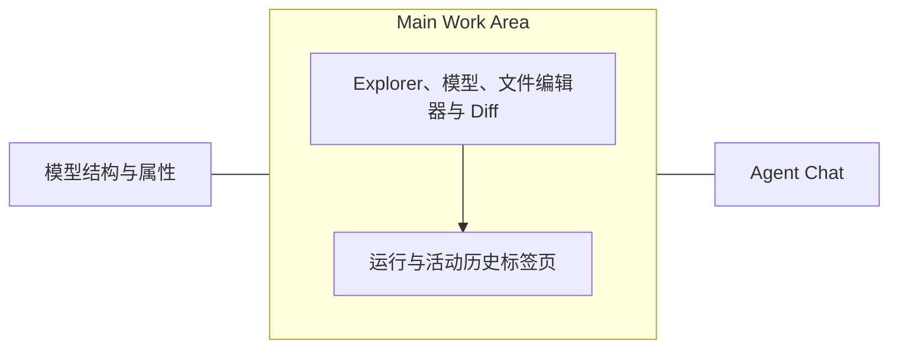

# CAD IDE 工作区

## 布局与实施约定

参考材料为用户提供的 1848 像素宽 CAD 截图及 VS Code 截图。保留应用左侧 FreeCAD 模型结构与属性、右侧 Agent 对话；Explorer 是中间源码工作区的子区域。菜单、紧凑选项卡与底部面板减少常驻按钮占用。运行和活动复用持久化事件，活动覆盖当前项目全部对话。



## 视觉检查与实际布局

全部截图采用 **1848 × 1048** 浏览器视口，与提供的两张参考图尺寸一致。

| 观察 | 实际呈现 |
|---|---|
| 原界面大量文字按钮、入口选择器挤占编辑区域 | 文件、编辑、选择、视图、运行菜单集中命令；Explorer 仅保留 `+`、`…`；主按钮运行当前文件 |
| 原文件树逐行显示改名、删除按钮，选项卡缺少关闭操作 | 文件树通过右键菜单操作；选项卡提供悬停关闭、中键关闭及批量关闭 |
| CAD 属性、聊天、执行记录职责交叠 | 左侧保留模型结构与属性；右侧保留聊天；运行和项目活动位于中间底部 |
| VS Code 用连续选项卡、紧凑 Explorer、菜单组织文件 | 采用相同的文件阅读方式，保留 CAD 模型与源码四种布局及候选验收 |
| 大量执行细节占用聊天阅读区域 | 聊天保留用户消息、Agent 可见回复、计划与任务摘要；工具、源码和检查详情进入活动及运行面板 |

底部面板可以收缩，通过分隔条拖动或方向键调整高度。切换标签、收缩、展开保留所选执行；浏览器测试核对其边界与中间区域完全一致。模型/源码并列时，Explorer 位于源码子区域。视图菜单控制 Explorer、Diff 和底部面板。当前界面保留浅色主题，CAD 模型占据独立视口；编辑器没有增加终端、调试器或系统文件浏览功能。

截图证据：

- [修改前工作区](../artifacts/ide-workspace/before/workspace.png)：已加载真实正式修订及 12 个三角面，截图时模型尚未完成绘制；用于比较面板、菜单和聊天布局。
- [修改后整体工作区](../artifacts/ide-workspace/after/workspace.png)：真实 40 × 30 × 10 mm 实体、正式修订、源码及运行面板；额外检查截图像素确认模型已经绘制。
- [运行面板](../artifacts/ide-workspace/after/run-panel.png)、[项目活动历史](../artifacts/ide-workspace/after/activity.png)
- [树内新建](../artifacts/ide-workspace/after/explorer-new-file.png)、[文件右键菜单](../artifacts/ide-workspace/after/explorer-context.png)、[实际拖动](../artifacts/ide-workspace/after/explorer-drag.png)
- [选项卡菜单](../artifacts/ide-workspace/after/tab-context.png)、[文件菜单](../artifacts/ide-workspace/after/file-menu.png)、[编辑菜单](../artifacts/ide-workspace/after/edit-menu.png)
- [多行选区](../artifacts/ide-workspace/after/selection.png)：保留当前行提示，蓝色选区清晰可见。

## 编辑、文件与运行语义

- `ProjectEditor` 为每个文件保存独立 `EditorState`，切换通过 `EditorView.setState` 恢复。普通保存保留撤销历史；打开资源文件也保留其他文件的状态。关闭文件释放对应状态。
- 菜单、快捷键、工具栏和右键菜单使用相同操作函数。保存当前文件、保存全部更新工作副本；检查点创建不可变项目版本。Diff 比较活动文件与已保存内容。新文件保持未保存标记，保存前显示新增差异。
- 内联名称支持 Enter、Esc，并检查非法名称和同名冲突。复制、剪切、拖动、改名同步文件、目录、打开选项卡、未保存缓冲区和默认入口路径。删除需要确认；关闭未保存文件提供保存、放弃、取消。移动后提示检查模块导入与资源路径，平台保留源码中的导入表达式。
- **运行当前文件**冻结完整项目，并把活动 `.py` 或 `.FCMacro` 记录为该执行快照的入口。**运行项目**使用工作副本默认入口。**设为项目入口**显式更新工作副本配置。非可执行资源禁用运行；缺少文档或实体的 Python 模块得到实际几何检查失败。
- 执行快照沿用现有源码 head 和候选验收机制，工作副本保留默认入口；执行记录中的入口可以与默认入口不同。后续 Agent 任务沿用已有工作副本冻结流程。运行期间的新编辑不能改变已冻结执行的内容。
- 用户运行自动打开运行面板，执行成功产生候选，用户验收后提交正式修订。运行失败保留原正式模型。用户运行不会向聊天插入 Agent 工具过程。
- `RunPanel` 从现有任务、执行详情和 `cad_progress` 事件显示 Python 执行、独立重开、健康/任务验收、STEP/GLB 检查、日志与候选状态。历史执行读取自身结果；活动中的执行记录可以定位具体运行，文件变化可以定位源码及 Diff。
- 普通保存通过现有事件存储记录 `source_workspace_saved`，包含修改者、文件变化和差异；它不创建永久源码版本。工具开始/结束仍合并到同一活动记录，没有增加历史数据库。

## Agent 文件组织证据

`gateway/source-tools.ts:createSourceTools` 使用 Pi Coding Agent 的 `createReadTool/createWriteTool/createEditTool` 工厂，并适配到项目快照。`write` 可以创建不存在的项目相对路径；`edit` 要求已有文件。`cad_files` 提供 `list/mkdir/delete/move/set_entrypoint`，文件创建通过 `write` 完成。每次 Agent 写入保存完整不可变项目版本和文件差异。

与截图项目对应的 L 形支架任务 `3b5e3d50-4e17-4ae5-92f4-09883f0b04d7` 中，真实事件依次包含：146 列文件、150 读取 `script.py`、161 写入 `script.py`、166 运行、176 修改 `script.py`、184/200 再次运行。源码事件 162/177 均记录修改 `script.py`。记录没有新建文件尝试，也没有创建权限失败。证据见 [脱敏文件操作记录](../artifacts/ide-workspace/agent-file-choices.json)。现有材料能够确认 Agent 选择了已有文件，无法确定该次模型决策的内部原因及完整历史提示词。

当前系统提示词和工具说明明确区分独立新设计、新增可复用模块与修改已有设计：独立设计创建有意义的新入口文件，模块通过必要的导入集成，修改请求编辑相关已有文件，并保留无关内容。工具能力和 Schema 沿用现有实现。真实 Pi 文件工具及 FreeCAD 测试验证新文件、独立入口、导入、Diff 和原文件保护；自然语言模型是否遵循更新后的说明尚未进行在线验证。

## 修改模块与接口

| 文件 | 职责与本轮修改 |
|---|---|
| `web/src/App.tsx` | 中间底部面板、项目活动聚合与跳转、聊天内容划分、模型结构标题 |
| `web/src/SourceWorkspace.tsx` | Explorer、选项卡、命令菜单、保存、入口选择、导入导出、历史定位 |
| `web/src/ProjectEditor.tsx` | 各文件独立编辑状态、撤销重做、查找替换及真实剪贴板操作 |
| `web/src/IdeMenu.tsx` | 共用菜单显示、定位与键盘操作 |
| `web/src/RunPanel.tsx` | 真实执行事件、状态、日志、验证和候选验收 |
| `web/src/ide-files.ts`、`web/src/ide.css` | 路径操作校验、IDE 布局、面板及选区样式 |
| `web/src/activity.ts` | 普通保存事件进入现有活动聚合 |
| `gateway/source-versions.ts` | `checkpointRun` 冻结单次执行入口并保留工作副本默认入口；普通保存事件 |
| `gateway/server.ts` | 现有源码检查点接口接受仅用于运行的可选 `executionEntrypoint` |
| `gateway/source-tools.ts`、`gateway/pi-adapter.mjs` | 文件创建与设计组织说明 |
| `tests/ide-entrypoint.test.ts`、`tests/ide-files.test.ts`、`tests/project-workflow.test.ts` | 真实存储、路径和 Pi 文件工具/FreeCAD 验证 |
| `tests/e2e/ide-workspace.spec.ts` | 六个 IDE 浏览器场景，覆盖编辑、文件操作、菜单、运行与截图 |
| `tests/e2e/helpers.ts`、`project-workspace.spec.ts`、`source-execution.spec.ts`、`python-workflow.spec.ts`、`assembly.spec.ts`、`approval-preview.spec.ts`、`workspace-layout.spec.ts` | 使用现有菜单和中间活动区域执行回归；这些测试文件均位于 `tests/e2e/` |
| `scripts/audit-design-file-choices.ts` | 只读查询已有 L 形支架任务的工具和源码事件 |
| `README.md`、本文、`artifacts/ide-workspace/` | 使用方式、测试与浏览器证据 |

Pi 内部源码、Worker、执行隔离、模型协议、模型配置及正式修订提交机制没有因本轮工作改变。没有新增依赖。工作区原先已有的其他修改继续保留；完整 `git status` 包含此前工作。

## 实际测试结果

测试使用已有 FreeCAD 1.1.3 和浏览器环境。直接运行、几何和交付检查执行真实 FreeCAD。已有离线对话回归通过项目原有规则提供器选择操作，没有调用真实模型服务；它们不能证明在线模型的文件组织行为。

| 命令 | 结果与覆盖 |
|---|---|
| `npm run test:unit` | 42 个文件、186 项通过；含真实存储、Pi 文件工具、新设计文件、导入及执行 |
| `npm run test:cad` | 32 项通过；含原生几何、Python 执行、重开、交付与隔离 |
| `npx playwright test --reporter=line` | 33 项通过；含四种布局、项目/对话恢复、审批、候选、取消、错误、导出及六项 IDE 场景 |
| `npx playwright test tests/e2e/ide-workspace.spec.ts --grep "workspace shows" --reporter=line` | 1 项通过；真实模型绘制像素检查及整体截图 |
| `npm run build` | 独立构建及浏览器回归启动时构建均通过 |

所有命令均使用 `TMPDIR="$PWD/.work/tmp"`，测试临时目录位于项目内。浏览器六项场景进一步验证：A/B 文件分别撤销重做、保存后历史保留、打开资源文件后恢复编辑；内联创建、名称冲突、剪切粘贴、带未保存缓冲区的移动；选项卡关闭确认及批量关闭；真实剪贴板和查找替换；保存全部不会运行或产生检查点。

真实执行场景使用同一项目的 `.FCMacro`（24 × 16 × 6）、导入项目模块的 Python 入口（12 × 14 × 9）和项目默认入口（40 × 30 × 10）。前两次运行均核对默认入口未变，第三次验收正式修订；随后执行异常脚本及无文档模块，核对正式修订仍为 1。活动跳转返回首次执行时显示其实际尺寸。工具测试创建独立设计文件并执行、修改，同时核对无关文件内容保持不变。

### 未通过检查

`npm run typecheck` 失败：`pi/packages/ai/src/api/openai-client.ts:8`，`TS2341: Property 'fetch' is private and only accessible within class 'OpenAI'`。这是现有 Pi OpenAI 客户端与已安装依赖的类型兼容问题；本轮没有修改该文件。输入用户提示词：不适用，此项属于静态类型检查。应用构建及上述实际测试已通过，完整类型检查仍未通过。

### 未执行及限制

- 没有调用真实模型 API；独立新设计自然语言行为、在线 Agent 执行行为没有重新验收。
- 浏览器使用 Chromium 的 SwiftShader 实际绘制；没有验证其他浏览器和硬件显卡。
- 修改前截图只能证明布局与正式修订加载状态；修改后的模型像素检查及现有视口回归证明实际几何绘制。
- 剪贴板菜单需要浏览器权限及安全来源；本地浏览器测试已实际授权并读写剪贴板。
- 文件或目录移动不自动改写 Python 导入表达式；用户需检查导入与资源路径，执行失败显示真实诊断。

## 启动与操作

已有运行环境准备完成后：

```bash
mkdir -p .work/tmp
export TMPDIR="$PWD/.work/tmp"
npm run build
CAD_PROVIDER=none npm run dev
```

打开 `http://127.0.0.1:3000`，使用启动日志指定的本地访问密钥登录。`none` 关闭模型调用，仍可导入文件、编辑、运行真实 FreeCAD 并验收候选。先选择顶部源码或并列布局，通过文件菜单导入工程；打开 Python 文件后点击播放图标运行当前文件，底部运行面板自动展开。普通保存使用 Ctrl/Cmd+S，保存全部使用 Ctrl/Cmd+Shift+S；独立版本通过“创建源码检查点”保存。

在线 Agent 沿用 README 的网页模型设置，或显式启动 `CAD_PROVIDER=live CAD_MODEL_CONFIG=advanced-model.yaml npm run dev`。需要有效服务凭据；本轮没有使用这些凭据。离线规则模式仍可使用 `CAD_PROVIDER=fake npm run dev`。环境要求、模型协议及验证说明见 [README](../README.md) 和 [Python 建模流程](python-modeling.md)。同一个数据目录由一个 Gateway 持有；已有服务运行时，在该服务中刷新页面使用新构建，避免重复启动。
