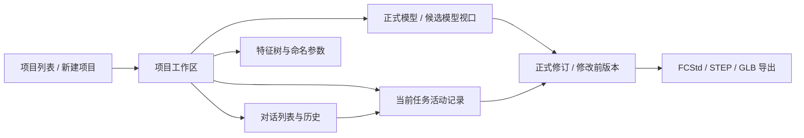
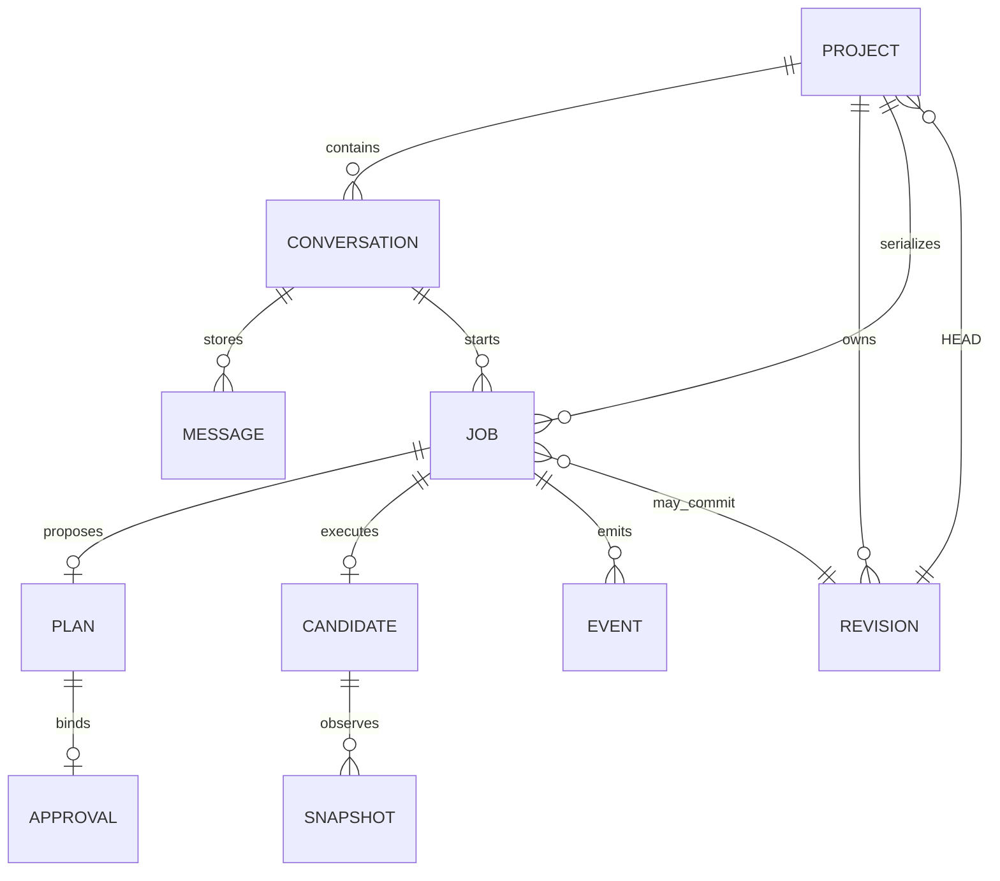

# CAD Agent 演示版产品研究与实施方案

技术审查日期：2026-10-29
仓库：`implementation/text-to-cad`，基线 HEAD `16be6a8`。本文保留参考产品调查、产品范围选择与技术设计；该 HEAD 为历史基线，当前工作区实现和验收结果见[第一版演示验收](v1-demo-validation.md)。参考产品观察仍限于原调查实际取得的证据。

## 执行架构与批准边界

推荐执行架构为**一次任务计划审批 + 批准范围内的 Agent 工具执行 + 服务端逐次写入校验**。Agent 先在只读阶段解析需求并生成结构化计划，用户每个建模任务批准一次。批准后 Agent 继续使用当前 CAD 工具；服务端根据计划、候选文档实际状态和参数逐次授权。草图、约束、Pad、候选几何、验证和导出均来自真实 FreeCAD 文档。首个切片的授权范围限定为一种矩形草图及其 Pad；执行架构的选择不扩大 CAD 能力范围。

首个端到端切片以 40×30×10 mm 长方体验收：需求解析 → 结构化计划 → 用户批准 → 矩形草图和约束 → Pad → 候选视口 → 几何验证 → 保存 → 独立重开 → STEP/GLB 导出 → 正式提交。尺寸来自结构化计划，验收样例的数值不写死在解析器中。任一步越界或失败时停止任务、隔离候选、保留正式 HEAD，并显示实际失败步骤。

批准前允许读取正式模型、生成计划、显示设计构想和检查参数；禁止创建 CAD 候选、写入 FreeCAD 或导出候选。批准绑定本次需求、允许的特征/操作范围、参数约束、验收条件、planHash 和 base revision。批准后 Agent 每次调用写工具时都由 Gateway 核对批准范围。模型资格必须覆盖本次规划、分阶段调用及结束协议；既有自动建模结果只能作为历史依据。

### 本次代码核查的证据边界

工作区包含尚未提交的计划、审批、候选快照及前端实现。当前代码与实施检查点如下；存在代码与完成验收分别记录：

| 已实现机制 | 当前验证证据 |
| --- | --- |
| `runPiLoop` 将只读规划和获批执行分开，`createPlan` 校验结构化参数并生成验收条件。 | 最新真实在线浏览器运行成功生成长方体、增加中心贯穿孔、把孔径从 6 mm 改为 8 mm；三项计划均经用户批准，见[验收记录](v1-demo-validation.md)。另一次运行在首个规划请求时收到通用模型请求错误，未发生工具调用或 CAD 写入；该次错误没有保留上游状态码。 |
| `authorizeOperations` 按有限阶段、对象、几何、约束引用和尺寸授权；`assertCandidateSnapshot` 回读实际草图及候选几何。 | `npm run test:unit` 126 项、`npm run test:cad` 22 项通过。正向和反向约束引用均由真实 FreeCAD 文件验证；三份在线下载文件使用当前独立验收程序重新打开并通过。 |
| `Supervisor.approveJob` 事务检查计划、HEAD 和项目写资格；候选创建前再次检查。待批任务可恢复，获批任务占用项目写资格。 | 审批、计划与项目事件测试通过；两个对话可保存待批计划，过期审批不能改写正式版本；刷新和重连浏览器回归通过。 |
| Worker 发布实际操作事件、草图回读与候选 GLB；前端分别显示待批计划、候选观察和正式视口。 | 当前离线浏览器回归 10 项通过；最新真实在线运行观察到候选模型、修改前后画面、历史候选和三份修订的下载。 |

`worker/validation.py::validate_design` 现通过 `sketch_snapshot` 比较保存后重新打开的实际草图约束集合、约束类型、几何/端点引用、尺寸、Pad Profile/长度/方向/Tip。新增的真实 FreeCAD 反例保留相同外形、体积与完全约束状态，只更改约束引用，独立进程会拒绝。对已完成的长方体、Ø6 孔、Ø8 孔三份真实下载重新执行文件验证后均通过，记录见[第一版演示验收](v1-demo-validation.md)。

`candidateSnapshot` 在异步等待返回后重查取消、批准及持久任务状态，并在同一 SQLite 事务内更新 job 与追加快照事件。相关单元测试覆盖非法依赖顺序、实际约束引用、候选 HTTP 资产与迟到快照取消竞争。成功任务的最后一个实体检查点可作为只读历史候选加载；真实在线浏览器验收覆盖该入口、实时候选和三份正式下载的 manifest 字节哈希。

当前测试包括计划与审批契约、候选原生建模、候选 HTTP 与浏览器预览、真实在线长方体/孔/孔径修改。每个 M1/M2 真实任务的计划、批准记录、CAD 事件、几何检查与文件包均分别核对；测试入口与结果列于[验收记录](v1-demo-validation.md)。

当前工作区通过 `npm run doctor`、`npm run verify:pi`、`npm run typecheck`、FreeCAD CAD 和浏览器回归；完整数量与结果见[验收记录](v1-demo-validation.md)。真实在线长方体、孔及孔径修改最新完整运行通过。另一次首个规划请求以 `stopReason=error` 结束，0 工具调用、0 token，FreeCAD Worker 未启动，正式版本未改变；该次通用错误缺少上游状态码，具体原因无法确定。适配层现已保留 HTTP 状态码并丢弃响应正文，两种协议的本机 HTTP 错误测试通过。

### 正确性要求与实现选择

| 必须证明的性质 | 本项目的最小实现选择 | 可以替换的部分 |
| --- | --- | --- |
| 批准内容确实限制写操作 | 每个任务一份不可变计划；批准绑定请求、项目、任务、基线、参数、验收条件和契约版本；每次写入前检查。 | 计划内嵌 job JSON；SHA-256 用于比较内容。完整对象比较也能实现内容绑定，无需独立审批服务。 |
| 用户看到实际建模过程 | Agent 请求、授权结果、Worker 操作及事务结果分别记录；成功批次后回读实际草图和候选实体。 | 首个切片选用两个事务批次、两个检查点及 SVG 草图展示；无需逐条约束生成文件。 |
| 阶段与结果符合批准 | 写入前比较有限操作契约，批次后验证实际文档，提交前及独立重开后检查真实结构与几何。 | 精确操作集合是当前授权算法；只有增加等价建模路径的真实需求时才扩展判定规则。 |
| 失败不能污染正式模型 | 候选与正式文件隔离；完整包通过验证后检查正式基线并提交；任何失败停止本任务的后续写入。 | 复用 staging、SQLite 和 revision manifest；不需要计划分支、候选版本数据库或工作流引擎。 |
| 视口与文件属于同一版本 | 候选按身份及 sequence 加载；正式 GLB、树、参数、验证结果和下载绑定同一 revision 包。 | 组件拆分方式、候选面板的位置和缓存实现可以调整；身份检查与整体切换必须保留。 |

## 参考产品观察与证据

| 参考 | 可以核实的内容 | 证据等级和限制 |
| --- | --- | --- |
| [Varen CAD 产品页](https://vanyu0710.github.io/Varen-AI-CAD/) | 页面标注 V0.25.1-BETA、Windows x64。公开描述的过程为需求理解与必要提问、生成 BOM/零件参数/建模计划、用户批准、逐件参数化 B-Rep 建模、几何与装配干涉检查，再交付。页面展示减速器和变速器案例图片及统计，并称其面向概念设计与快速原型。 | 原调查已打开并阅读网页；页面文字与图片属于发布方材料，独立运行行为尚未验证。没有启动或操作 Beta，也未验证案例、审批交互、恢复行为或界面状态。页面也说明它不提供完整 2D 工程图、通用装配配合或运动求解。不得把这些公开宣称写成实测事实。 |
| [小红书视频链接](https://www.xiaohongshu.com/explore/6ae1de6f000000001401c505?app_platform=android&ignoreEngage=true&app_version=9.51.0&share_from_user_hidden=true&xsec_source=app_share&type=video) | 未能确认视频功能或流程。 | 原调查访问重定向到 404 / 页面不可用，没有可读视频、截图或字幕。需要负责人提供可访问录屏或截图，或提供作品公开的新链接。 |

本报告没有复制参考产品源码，也没有将参考产品仓库实现作为依赖。若后续提出代码复用，必须先定位具体仓库、固定版本或 commit、核对对应许可证和依赖，再做兼容性审查；当前没有做这项仓库与许可证审查。

**从公开证据可提炼的演示交互**：先理解需求，必要时澄清；执行过程可见；完成后以检查结果而非口头承诺交付；失败原因和交付状态可追踪。BOM、多个零件、装配间隙/干涉分析和计划批准属于 Varen 页面公开描述的能力，不应被误写为当前项目能力。

## 已提交系统能力与验证记录

### 已有用户流程和模块

本节记录 HEAD `16be6a8` 的产品基线与历史验证。工作区新增的计划、批准、原生操作事件及候选界面已在“本次代码核查的证据边界”单独列出；实施任务以实际工作区内容继续，不重复创建已有模块。

| 用户需求 / 当前行为 | 代码与接口 | 依赖、验证及未覆盖点 |
| --- | --- | --- |
| 配置在线模型并启动 | `web/src/ModelSettings.tsx` 选择 Chat Completions / Responses、填写 endpoint/key/model、发现模型、设置超时；`gateway/model-config.ts` 保存受限权限配置、迁移旧配置、探测工具往返；Pi 两种协议分别转换请求与流式事件。 | 真实 `advanced-model.yaml` 两种协议的全流程在线验收记录通过；`model.yaml` Responses 只读工具探测失败并返回服务不支持工具调用。每个模型/协议仍需独立资格测试。见 `docs/online-validation.md`。 |
| 创建项目并恢复模型 | 首页创建项目；工作区顶部列出、切换、改名。每项目独立 SQLite 元数据、HEAD、正式文件和对话。 | `web/src/App.tsx`、`gateway/server.ts`、`gateway/revision-store.ts`；E2E 覆盖项目隔离、刷新、切换。单一受信任服务访问密钥，无用户账户、角色或多人权限模型。 |
| 创建/切换对话和恢复历史 | 每项目默认有对话，可新建、改名、切换；地址包含 `document` 和 `conversation`。消息与任务事件分页持久保存。 | `conversations/messages/jobs/events` 表和 `conversationContext`。对话有独立聊天上下文；同一项目全部对话共享一个模型和修订历史，界面有提示。跨项目归属由 API 检查。 |
| 提交建模需求 | 当前聊天输入文字。Agent 系统说明限定单 Body、单连通实体、平面草图、命名约束、Pad/Pocket、已知参数编辑；有 `cad_inspect`、`cad_apply`、`cad_finish` 工具。 | `gateway/pi-adapter.mjs`、`gateway/agent.ts`、`shared/cad-schema.json`。缺关键尺寸时提示模型澄清；若模型只回复、未执行 CAD，任务状态为 `answered`，对话保留，HEAD 不变。没有专门的需求表单或用户确认计划状态。 |
| 执行中查看过程 | Pi 提供真实文字增量和工具开始/结束；Worker 提供几何、保存、重开、导出阶段，事件持久化并可回放。 | **有真实事件基础，无计划审批，也无逐步候选视口。** 当前 `tool_execution_start/end` 提供模型工具参数/结果，`cad_progress` 只报告验证/保存/重开/导出阶段；前端任务卡在完整记录模式显示参数 JSON，但没有从中呈现结构化草图/约束预览。没有模型阶段性 thinking 的伪动画。 |
| 检查和修改模型 | 三维视口加载版本化 GLB；正式特征树/参数由已提交 revision 提供；属性编辑走候选任务。 | **当前视口、树、属性、下载都绑定正式 revision；这是安全优势，也意味着运行中的候选变化不可见。** `WorkspaceStore` 不消费候选树或候选 GLB。Before/After 只保留最近显示过的完整正式版本。 |
| 验证、保存和导出 | FreeCAD Worker 在候选目录修改，不直接写正式文件；检查单 Body、单 solid、有效实体、完整约束、包围盒、体积和指定参数；保存 FCStd 后由独立 FreeCAD 进程重新打开，再导出 STEP、GLB；清单哈希和 SQLite HEAD 原子提交。 | `worker/candidates.py`、`worker/validation.py`、`worker/artifacts.py`、`gateway/revision-store.ts`。浏览器 E2E 会下载三种文件，由原生 FreeCAD 独立重开/检查 STEP 与 GLB；失败、取消、冲突、Worker 崩溃不会替换正式修订。导出文件属于同一不可变修订包。 |
| 失败、取消和恢复 | 任务状态含 queued/running/validating/committing/committed/answered/failed/cancelled/interrupted；可取消并可重试失败文本；重启不重放操作，旧版本保留。 | `gateway/supervisor.ts` 和页面任务列表。Gateway 中断前已持久化消息可恢复；中断任务不可续跑，只能重新提交。当前文案有通用错误映射和技术详情，缺少为协议错误、参数拒绝、无效几何、保存失败、导出失败分别设计的完整操作建议。 |

### CAD 能力边界

当前工具接受受限结构化操作：建立一个 Body；在 XY/XZ/YZ 平面建立线/圆草图；添加受支持的几何约束；创建 Pad 或 Pocket；修改有名字的约束尺寸或 Pad/Pocket 长度。草图需要完全约束，结果要求一个有效实体。当前系统拒绝任意 Python、文件操作、STEP 编辑、装配和工程图。几何检查由 FreeCAD/OCCT 的实际 B-Rep、尺寸、体积、solid 数和重新打开结果支撑；GLB 只用于显示，不作为制造尺寸权威。

### 通过与未通过的验证

以仓库当前验证记录为准，不以旧版设计稿的“目标”当成功事实：

- 真实环境记录：FreeCAD 1.1.3、Python 3.11.14、OCCT 7.8.1；Pi 源码指纹与环境 doctor 通过。
- 应用回归（2026-10-27 超时设置更新记录）：TypeScript 类型检查通过；113 项应用测试通过；19 项 CAD 测试通过；8 项浏览器回归通过。测试使用真实 SQLite、HTTP/UDS、Worker、进程、FreeCAD 文件；并非全部为纯函数测试。
- 高级模型完整真实浏览器工作区链路：Responses 与 Chat Completions 各自通过创建实体、跨对话修改、项目隔离、事件、取消/重启中断保护、下载并用原生 FreeCAD 验证的场景。
- 高级模型固定复杂样例集：Chat Completions 6/10，失败包括几何验收不符、超时、工具循环和对缺少尺寸时自行选择尺寸。记录明确为 `modelQualityQualified=false`；不满足“高级模型通过所有测试”。Responses 尚未执行该固定复杂样例集。
- 普通模型 `model.yaml`：早先一次真实普通任务在创建成功后，尺寸编辑期间模型重复产生额外 `arguments` 包装和错误参数，达到工具调用限制，候选未提交。随后同一失败任务的定向实验对比了真实 SSE、Pi 解析/保存、工具执行参数、界面文字、正式 FCStd/STEP/GLB 哈希及下载，记录未发现框架输入输出不一致。此结论只适用于该实验，不表示普通模型验收通过。
- 普通模型 Chat 协议探测通过；Responses 探测被服务明确拒绝，报告为“不支持 Function calling”。这属于该服务/协议的可用能力限制，CAD 几何验收需要另行执行。
- 在线回归证明了一组真实闭环，不等于模型准确率或多种服务普遍兼容。没有新发起模型调用或评测。

主要记录：[在线模型与工作区验证](online-validation.md)、[阶段状态](phase1-status.md)、[真实环境和测试证据](evidence/phase1-final-verification-2026-10-24.json)、[原生 CAD 测试日志](evidence/phase1-final-tests-2026-10-24.log)。历史记录时间与本次调查日期不同，报告保留原日期以免误导。

## 已提交实现与参考产品差距

本节以 HEAD `16be6a8` 的已提交产品及对应历史测试为基线。工作区中的计划、审批和候选展示实现状态见“本次代码核查的证据边界”；本节中的缺口仍需在新链路上验收。

| 参考交互目标 | 当前状态 | 要补齐的产品差距及技术层 |
| --- | --- | --- |
| 需求确认与计划审批 | Agent 指令要求缺少关键尺寸时澄清，但没有单独的计划或批准对象；有效任务自动执行并在几何检查后提交。 | 推荐每个建模任务先批准一次计划。需要持久化 job phase、批准前禁止 CAD 写入、计划 hash/base revision 绑定、审批入口和重启恢复测试，属于 Agent Runtime + 数据模型 + UI。 |
| BOM、多零件、装配和干涉 | 无。单 Body/单实体约束由提示词、schema、Worker 和验证执行。 | 新 CAD 操作、实体/装配数据模型、引用关系、装配求解、干涉检查及相应评测，超出 UI 改善和当前 Text-to-CAD 范围。 |
| 实时活动 | 有真实流式增量、工具状态、Worker 阶段事件和失败/取消/提交状态。 | 目前各信息混合在每个任务卡片；需将活动区分成消息、CAD 命令、验证步骤和最终修订，并明确重连去重与部分消息状态。主要是 UI 和事件渲染，底层事件已有。 |
| 树、属性和版本检查 | 有特征树、命名参数、安全修改、当前/前一完整版本查看和版本绑定下载。 | 缺少更清楚的“当前正式版本/历史版本”导航、验证摘要与导出状态；无任意操作历史编辑、分支或版本合并。主要 UI/少量快照字段，分支功能则需数据模型。 |
| 可追溯失败处理 | 有失败状态、部分错误分类、原对话、技术详情、重试按钮和候选隔离。 | 错误类别与下一步操作不够系统化；没有“重试模型请求/重新规划/重新运行整个 CAD 任务”的清楚语义。需要统一错误分类、状态事件和逐类验收。 |
| 多项目/多对话 | 已有项目、对话、持久消息及事件、刷新恢复、项目切换隔离；同项目共享模型并串行写入。 | 当前前端使用 `window.prompt` 命名，导航和空项目入口较工具化；任务历史和活动信息留在单个工作区，没有独立项目主页。主要信息架构与导航 UI。 |

### 已提交实现的演示步骤与缺口

| 演示步骤 | 当前证据分类 | 核实结果与本轮设计要求 |
| --- | --- | --- |
| 用户输入自然语言需求 | **当前真实实现且有测试** | `POST /jobs` 保存原始文字，Pi 请求上下文含正式 revision 与特征摘要。 |
| 缺参数时澄清 | **有技术基础，缺交互状态/行为资格** | Agent 系统指令要求缺少关键尺寸时提问；任务可进入 `answered`、不提交。后端能检查提案参数齐全、数值合法及单位；它不能仅凭 schema 证明某个数值来自用户。缺参提问行为需要真实模型资格用例，审批卡同时展示原需求及全部尺寸。首个完整尺寸长方体切片不依赖通用自然语言参数来源判定器。 |
| 展示结构化建模方案 | **需要新增 Agent Runtime 与持久状态** | 目前没有计划对象或计划阶段。需使用只读规划调用生成本切片的设计意图、尺寸、结构操作范围和验收条件，先经 schema 校验再持久化供 UI 审阅。 |
| 用户确认/修改计划 | **需要新增后端与 Agent Runtime 状态** | 现有写任务收到后立即排队，Worker 开始候选操作；没有批准接口。批准前需后端拒绝 CAD 写入。首个切片保存单个计划与批准记录；用户改变尺寸、拓扑或特征方案时创建新任务并重新批准。 |
| 显示草图几何、约束、Pad/Pocket | **真实 CAD 操作已实现；逐步事件/可视化缺失** | `worker/model_ops.py` 真正执行线/圆、命名约束、Pad/Pocket；`cad_apply` 返回 inspect tree，但一般是一批操作完成后才回传。未向前端发布逐操作实际事件。 |
| 展示模型/特征历史逐步变化 | **需要 Worker 候选快照能力和 UI** | `cad_apply` 返回真实特征树，但页面只消费正式 revision；尚无候选快照读取能力。需要从候选文档读取草图、约束和临时 GLB，并清楚标记未提交。 |
| 几何检查、保存、重开、导出 | **当前真实实现且有测试** | Worker 由 FreeCAD 检查有效 solid、包围盒、体积、约束/参数，保存 FCStd 后独立进程重开，再导出 STEP/GLB，事件有真实阶段。完成后由 revision manifest 与 SQLite HEAD 发布。 |
| 当前正式模型与最终文件一致 | **当前真实实现且有测试** | 正式树、参数、预览与文件共用 revision manifest；E2E 下载后由 FreeCAD 重开和检查。新增候选预览后，还需验证成功时发布同一候选，失败时恢复旧 HEAD 视图。 |
| 失败原因和旧模型保护 | **保护已真实测试；分类/呈现部分不足** | 候选不通过不推进 HEAD，Worker/Gateway 故障保护经过测试；UI 有技术错误但多个阶段仍映射到通用文案。新增 CAD 操作事件后，记录实际失败步骤和 FreeCAD 诊断，并显示候选失败及正式 revision 未变。 |
| 拒绝/取消/无效几何不得提交 | **保护有真实测试；审批交互仍需开发** | `answered` 与 cancelled/failed/interrupted 终态存在，HEAD/hash 保护已测。计划拒绝、批准范围拒绝及待批任务刷新/重启需要新增状态测试。 |
| 标杆界面的具体观感/细节 | **尚缺少参考产品证据，暂无法判断** | Varen 只能核实公开页面图文；小红书无法访问。不能据此复制布局或断言具体确认按钮、时间线样式；先以“能辨认真实步骤和模型变化”为内部验收目标。 |

## 执行架构比较

| 方案 | 可演示流程 / 可宣称能力 | 必需改动与可复用部分 | 依赖、风险与验收影响 | 明确不支持 |
| --- | --- | --- | --- | --- |
| **A. Agent 在批准范围内调用 CAD 工具（推荐）** | 用户批准设计意图和边界后，Agent 逐步调用受限 CAD 工具；实际草图、约束和特征随 FreeCAD 操作更新，再完成验证与交付。 | 复用现有 Pi 工具调用、`cad_apply`、Worker 操作和候选事务；增加持久批准范围、写操作前的服务端判定、operation 事件和候选快照。 | 服务端需检查目标对象、结构、参数和验收条件；有限长方体规则的复杂度可控制。批准范围表达不完整会导致漏拦或误拦，自动化须覆盖允许调用、越界调用和失败保护。通用局部修复另需规则与审计设计。 | 首个切片之外的特征和修复策略不自动获得权限。 |
| **B. 服务端执行冻结的 CAD 操作序列** | 批准后由服务端按计划运行 CAD 操作，现场每一步仍来自真实 FreeCAD。 | 当前 `approvedStages` 已能生成参考操作，可直接复用它、结构化程序执行路径和 Worker；补齐两阶段驱动及冻结内容/规则版本绑定即可。 | 对固定长方体实现直接，消除执行期间再次生成写参数的模型误差；风险集中在计划到操作的生成规则和执行状态。扩展新操作类型仍需增加生成规则及原生验证。逐条比较冻结内容与实际 RPC。 | 模型不能临场改变操作；程序未定义的错误恢复需要新计划和批准。 |

**推荐方案 A，采用受限长方体计划和确定性逐次授权。** 当前 Pi 已由 Agent 调用 `cad_apply`，保留这条链路可以展示 Agent 实际选择的工具和 FreeCAD 的真实执行结果。首个切片明确限制几何类型、对象引用、参数、调用阶段和验收条件；服务端用这些可计算条件表达设计意图，不尝试理解任意自然语言授权。首个切片不提供自动修复，因此此时 A 的优势集中在复用现有工具链和保留真实 Agent 执行过程，不能宣称它已经具有额外的错误恢复能力。

这里推荐的是**有限操作契约下的 Agent 执行**：模型负责生成计划和实际工具参数；服务端依据确定规则批准或拒绝调用；Worker 执行获准操作。首个切片只有“完整矩形草图与约束”“Pad”两个写入阶段。对象引用、几何和尺寸固定，Agent 可以安排满足依赖的批次内顺序、读取状态、解释结果和请求结束；不能选择其他建模方法。工作区 `approvedStages` 已把这类有限规则表示为操作集合，`authorizeOperations` 通过规范化比较判定。即使授权规则与冻结执行器采用相同参考操作，实际请求的发起者、执行失败的责任位置及事件来源仍须准确展示。

首个切片不实现任意设计意图的语义授权，也不支持“结果大致相同即可”的操作放行。允许同义建模路径需要能够检查其特征结构及中间状态的额外规则；当前长方体目标没有这个依赖。若产品要求批准后完全消除模型工具参数错误，选择 B 更合适，演示文字也应明确操作由服务端执行。保留 A 的依据是现有 Agent 工具链和可审计的真实模型调用，不能把有限契约描述成通用自主修复。

冻结序列 B 同样可以展示真实 CAD 过程。若产品要求服务端保证批准后严格复现固定操作程序，B 是成立的选择，需要明确展示“Agent 制定方案、服务端执行方案”的分工。两种方案都必须保留候选隔离、实际几何验收和提交事务；它们的差异在于下一步操作的选择者及授权表达方式。本切片采用 A 的有限操作契约，复用现有执行入口；不同时开发两套执行器。

| 比较维度 | A：批准范围内的 Agent 执行 | B：冻结操作程序执行 |
| --- | --- | --- |
| 真实建模展示 | 模型工具请求、授权结果、Worker 操作分别展示；禁止把被拒绝请求标成已执行。 | 展示模型生成的方案和执行器实际操作，执行期间的操作来源标为服务端。 |
| 批准约束 | 对象、坐标、约束引用、参数、阶段和最终结构逐次判定；仅操作白名单不足以授权。 | 批准规范化操作列表及验收目标；执行参数必须等于冻结列表中的相应内容。 |
| 可恢复错误 | 写入成功后可以读取实际状态并决定何时请求下一阶段；写入失败后只有预先批准并经过测试的修复规则才能允许继续。首个切片没有此类规则，立即终止写任务。 | 可以执行程序事先定义的检查与恢复分支。首个切片没有恢复分支，写入失败立即终止。 |
| 越界识别 | 结构规则和实际文档状态不满足即拒绝；不能用模型自述或文本相似度判断。 | 对比冻结操作、顺序和参数；任何更改需要新计划。 |
| 正式模型保护 | 候选写入，独立验收后比较 baseRevision 并提交；失败不更新 HEAD。 | 相同。冻结程序也可能产生无效几何，仍需真实验收。 |
| 实现及回归风险 | 复用 Pi 工具链；有限判定器需防漏拦、误拦，执行期间仍可能发生模型参数错误。 | 可复用现有操作生成器和程序执行路径；首个固定切片可能更简单。主要风险是生成规则失真和两阶段驱动；无须通用编译器。 |
| 自动化证明 | 对每次允许/拒绝的请求核对原始参数、批准对象、RPC、文档回读和最终包；覆盖等价顺序与越界反例。 | 对冻结列表与实际 RPC 逐项比对，再核对文档回读和最终包；几何证明要求相同。 |

选择 A 的具体工程成本是维护这一种矩形契约的前置条件、允许操作及真实回读检查，并验证判定器同时接受合法调用、拒绝越界调用。B 可以省去执行期间模型生成参数的失败，但需把调度草图、Pad 和结束条件的责任移入服务端。两者都能形成真实 CAD 演示；当前目标要求观察 Agent 的真实工具执行，现有 Pi、`CadSession.apply/prepare` 和操作事件可以直接复用，因此采用 A。首个切片中 A 的错误恢复自由度与 B 相近，不能以自动修复能力作为当前推荐依据。

### 批准范围如何转化为可判定条件

对首个切片，“设计意图”的可执行定义为 `create_box` 契约及其精确尺寸；自然语言由模型解释并通过批准卡交给用户确认。服务端不使用另一次模型判断来授予写权限。每次写入依次检查下列条件：

| 检查位置 | 首个切片允许的条件 | 拒绝时的行为 |
| --- | --- | --- |
| 请求身份 | job、项目、请求摘要、planHash、契约 version、baseRevision 与持久批准相同；任务仍有执行权限。 | 不调用 Worker，记录批准失效或任务终止。 |
| 第一批操作 | 新建 `Body`、位于 XY 原点的 `base`；四条指定线段；11 个指定约束。允许非尺寸约束使用其他唯一名称、允许满足引用依赖的约束顺序变化。 | 多余、遗漏、错误坐标/引用或合并 Pad 均拒绝，后续写入与提交锁定为失败。 |
| 第二批操作 | 第一批真实回读通过；仅创建 `pad`，Profile=`base`，Length=10 mm。 | 提前 Pad、重复草图、其他特征及参数修改均拒绝。 |
| 实际状态 | 每批回读对象、线段、约束类型/引用、Placement 和求解状态；最终验证 Profile、方向、Tip、有效实体、尺寸与体积。 | 阶段不继续推进，不提交候选；保留实际差异。 |
| 文件与提交 | 按批准 criteria 保存、独立重开和验证导出；完整正式包校验通过；HEAD 仍为批准基线。 | 保留原正式包与 HEAD，显示实际失败阶段。 |

11 个约束为四个端点重合、两个水平、两个垂直、一个原点定位和两个命名尺寸。这套约束是当前矩形实现选择；“闭合、完全约束且参数准确”属于必须验证的性质。首个切片只授权该明确形式，增加另一种等价约束形式需要补充规则和原生测试，无需改变任务级审批单位。

该有限实现中，A 与 B 允许的最终 CAD 操作非常接近。A 保留真实模型工具请求和读写反馈，执行时模型仍可能给出非法参数；B 将写入参数生成及阶段推进交给服务端。两种架构都无法仅凭最终体积证明用户批准得到遵守，因此都需要实际特征回读。当前推荐 A，依据为已有工具入口和授权实现可以直接复用；它的正确性依赖有限规则与真实回读，不能据此宣称通用的设计意图判断或自主修复。

### 长方体任务的成功、失败与设计变化

任务：用户要求创建 40×30×10 mm 长方体；批准内容为单 Body、一个 XY 矩形草图、完全约束、Pad 10 mm，包围盒和体积验收条件明确。

| 情况 | A：Agent 在批准范围内调用工具 | B：服务端执行冻结序列 |
| --- | --- | --- |
| 正常完成 | Agent 先读取候选，然后发出一次 `cad_apply` 创建 Body、矩形草图和全部约束。回读通过后发出第二次 `cad_apply` 创建 Pad，最后以批准 criteria 调用 `cad_finish`。服务端逐次授权，Worker 执行两次实际事务并产生两个检查点。 | 批准记录冻结操作内容及生成规则版本；服务端依次执行草图批次、Pad 批次和文件准备。Agent 可解释进展，但不决定下一次 CAD 写入。Worker 产生相同的真实事件和检查点。 |
| FreeCAD 几何操作失败 | 例如原生求解器在第一个草图批次返回约束冲突，Worker 中止该事务；显示真实失败约束和批次未完成，任务终止，HEAD 不变。读到诊断不产生修复权限。 | 在相同失败操作停止，中止当前事务并隔离候选，HEAD 不变；冻结程序不能跳过该约束继续 Pad。 |
| 需要改变设计 | 例如改为 35×30×10 或新增倒角，参数超出批准值/范围或拓扑增加；服务端拒绝 CAD 写调用，记录越界原因，要求生成新计划并重新批准。 | 原执行序列不包含新值或特征，执行结束或失败后由用户发起新计划和审批。 |

对于可恢复错误，必须区分“尚未改变候选的读取失败”和“写入或提交结果不确定”。例如一次只读检查未得到结果，A 可以在同一批准范围内再次读取，B 可以按固定读取规则重试；都不产生额外 CAD 权限。若 `cad_apply` 请求发出后连接中断，当前切片终止并隔离候选，禁止凭推测重发操作。已有批次幂等记录能够防止相同操作重复执行，但跨进程恢复还需要证明任务、批准和候选仍然有效，因此不能仅依据 stepId 自动继续。实际约束冲突、无效几何及未知文件状态均属于终止条件。

首个切片的长度、宽度、高度都是批准的精确值；几何验收容差用于浮点计算误差，不授予用户尺寸变化的权限。例如 FreeCAD 报告约束冲突时，Agent 不能删除约束、把 40 改成 39.9，或改用无草图实体。两种架构都终止当前候选。模型可以解释错误和建议新方案；新的 CAD 执行只使用基于正式 HEAD、重新批准的新任务。批准卡、允许操作、真实事件和最终几何必须共同验证，bbox/volume 检查单独不足以证明这一关系。

失败判定分三处：模型提交不同坐标、漏掉约束或提前请求 Pad，属于调用违背批准契约，Gateway 在 Worker 前拒绝；已获准的操作被 FreeCAD 求解器拒绝，属于真实 CAD 执行失败，记录原生诊断；操作正常返回但实际 Profile、方向、约束或几何检查不符，属于验收失败。三者均停止提交，诊断保留各自证据。若有效模型响应被框架错误转换或错误拒绝，须修复框架并重新测试，不能归类为模型能力问题。

### 最小审批规则

| 阶段 | 允许行为 | 审批要求与边界 |
| --- | --- | --- |
| 只读检查 | 读取正式模型树、参数、修订号和已有验证摘要。 | 不需要批准；不得创建候选或修改 CAD 文档。 |
| 生成计划 | 解析尺寸和目标；生成可读计划、设计意图、操作范围和几何验收条件。 | 不需要批准；规划调用没有写工具。缺关键参数时返回澄清状态。首个切片对补充答案创建新任务，携带同一对话的澄清历史及当前正式模型；不保留半成品候选。 |
| 用户批准 | 记录本次计划摘要、参数、允许的 CAD 操作范围和 base revision，以及决定与时间。 | 每个用户建模任务批准一次。当前服务没有用户账户，因此记录任务和决定，不记录自然人身份。 |
| 已批准操作 | Agent 调用已批准范围内的 `cad_apply`，或调用只读 `cad_inspect`。 | 不逐个询问草图、约束或内部工具调用；服务端在每次写入前校验范围。 |
| 局部修复 | 正常 `recompute` 和只读检查属于执行/验证的内部步骤；首个切片没有错误后的 CAD 写入修复。 | 失败后终止候选。新增修复规则必须逐类定义原生前置状态、允许调用、次数和重新验收要求；修改约束拓扑、删除特征、改变尺寸或放宽验收条件均要求新计划与批准。 |
| 改变设计 | 修改尺寸、草图拓扑、特征类型/数量、实体数量或验收条件。 | 服务端拒绝写入、终止本任务的执行权限并要求新计划和新批准；已保存的计划与批准记录保持不可变，用于核对已经发生的操作。 |
| 新的用户修改请求 | 用户要求改孔径、增加孔或改变其他已提交模型属性。 | 作为新任务处理，基于当前正式 HEAD 生成计划并重新批准。 |

首个切片局部修复策略为“无自动 CAD 写入修复”。Agent 可以追加只读诊断；正常 recompute 属于已批准操作和验证内部行为。参数解析失败不能由框架静默改写，删除冲突约束、改变线段方向、替换特征和放宽验收条件都不在批准范围。每次诊断仍记录实际工具调用和结果。新增写入修复规则必须有真实故障样本，并明确允许的原生前置状态、操作、次数与重新验收；未经该规则授权的修复需要新任务和批准。

批准后的 `cad_inspect` 可以读取本任务候选；批准前只读取正式修订。批准 API 的重复请求返回持久决定和当前任务状态，不重新排队；取消或中断之后重复批准不能恢复执行。Worker 已用 operationId、stepId 和操作内容记录批次幂等结果；Gateway 仍按阶段拒绝模型再次提交已完成阶段，首个切片不增加网络自动重试。输入契约拒绝、批准范围拒绝和真实 CAD 写入错误均使任务停止，Pi 即使尝试继续调用，Gateway 也必须拒绝后续写入和提交。保存、独立重开、导出和满足已批准条件后的正式提交属于这次批准，无需逐文件再次询问。新的用户修改请求始终建立新任务。

审批卡显示原始需求、目标尺寸、坐标方向、单实体要求、两个操作阶段及验收值。首个切片修改计划的操作为“拒绝当前计划，再提交修订后的需求”；可以用现有拒绝按钮和聊天输入完成，不要求新增计划编辑器。每个任务只有一份不可变计划。界面只在运行状态允许时显示批准按钮，服务端独立检查状态。批准与拒绝只能记录一个有效审批决定；批准之后仍可取消执行。取消、执行及提交竞争以数据库中的权威状态和提交事实为准，不以按钮点击顺序推断结果。

### CAD 产品范围

当前演示范围包括单 Body、单实体、矩形草图和 Pad，以及该实体的中心贯穿孔和孔径修改；三项操作各自需要批准并生成正式修订。多零件及装配目标需要项目级零件/实例模型、坐标变换与引用关系、装配约束求解、BOM、干涉真值和容差策略、装配保存/重开/导出及装配树；当前证据没有验证这些能力的无界面执行。该产品范围需要独立确认，不构成 A/B 执行架构的第三个选项。

## 产品设计

### 信息架构与真实画图展示



- **项目列表/项目创建**：显示名称、最近修改时间、正式修订号、活动任务提示；项目是 CAD 文档与对话集合的边界。
- **项目工作区**：顶部明确显示项目名称与当前正式修订。项目切换时先保存当前 URL 身份和事件游标，销毁旧预览订阅，再载入新项目完整快照。
- **对话栏**：只承载用户与 Agent 文本历史及各任务入口。支持新建、切换、改名。对话切换不切换模型，模型共享关系需在对话列表附近持续可见。
- **模型视口**：空闲时显示正式 GLB 与 revision。获批任务运行时显示显著标记的“候选预览 · 基于正式版本 N · 尚未提交”，保留正式版本查看入口；候选失败/取消立即隐藏候选并回到完整正式资产。候选预览来自 Worker 当前 FreeCAD 文档，不用静态动画。
- **特征与属性**：正式树始终来自已提交 revision。候选树来自 Worker 当前真实 `inspect_document`，候选视图只读；显示 Body、Sketch、Pad、Pocket 与稳定 ID。批准计划展示可读步骤，实际运行中逐项标为开始/完成/失败。尺寸来自 FreeCAD constraint/parameter 回读，不把计划文本当执行结果。
- **草图视图**：Worker 从候选 FreeCAD Sketch 的真实 Geometry、Placement、具名约束和尺寸生成只读快照；2D 草图面板按这些实际几何绘制线/圆及标注。首个切片只在批次完成后展示草图，显示实际 `FullyConstrained`；批次内部状态通过操作记录展示。复用工作区已有 `sketch_snapshot` 和 `SketchPreview`，不得将计划坐标直接当作已执行草图。
- **Agent 活动记录**：与聊天文字区分，按事件顺序呈现已批准计划、CAD 操作实际调用/结果、几何验证、保存、独立重开、STEP/GLB 导出、失败/取消/提交。模型文字是解释；工具/Worker/验证事件是发生事实。thinking 可选展示，但不作为执行步骤。
- **导出**：跟随所选正式修订；显示文件类型和修订号。候选未通过验收或模型载入不完整时不提供新修订下载。

当前实现可复用已有功能组件和接口；项目主页/导航可以在现有工作区之上增加，不需要整体重写 Web 或 Gateway。

#### 计划、审批和执行绑定

首个切片保存一份经过 schema 校验的长方体计划。身份沿用当前 `documentId`、`conversationId`、`operationId`，计划保存请求摘要、`baseRevision`、尺寸 `{length:40,width:30,height:10,unit:mm}`、验收条件及内容 hash；对象与约束规则由唯一的长方体契约定义。Agent 通过只读 `cad_plan` 提交结构化设计参数；Gateway 计算验收值，批准卡直接读取持久计划。原始请求和完整真实模型输出同时保留。schema 校验能保证计划结构，用户审阅计划负责确认系统对需求的理解，最终 FreeCAD 验证负责确认实际几何。

Gateway 复用 `gateway/revision-store.ts::stableHash` 的对象键排序，对规范化计划计算 SHA-256 `planHash`；数组保留语义顺序，禁止未知字段和非有限数值，单位统一为 mm。批准包含项目、任务、请求、baseRevision 和全部设计/验收字段；hash 是内容绑定机制，现有 bearer 身份校验负责接口访问控制。保存完整批准对象和 baseRevision 也能实现绑定，hash 是本项目采用的紧凑比较方式。每个任务只保存一份不可修改计划，新计划使用新 job。`version:1 + kind:create_box` 定义这一种矩形、约束、Pad 授权规则；改变规则时升级 version，旧版本仍按原规则执行，或明确失效后要求新任务。契约 version 不受支持时拒绝执行，不用当前规则重新解释旧批准。首个切片不增加规则注册中心或通用计划迁移器。

运行时行为为：建模请求先持久为 `planning`，只读规划 Agent 使用 `cad_plan` 输出计划；Gateway 校验后保存为 `awaiting_approval`。缺参时保存澄清结果，不提供写工具。用户批准后，执行 Agent 的上下文包含保存的批准对象和当前 CAD 只读状态。批准接口在 SQLite 事务中核对 job、planHash、base revision、文档 HEAD 和项目写锁，再将状态置为 `approved` 并排入队列。HEAD 已变化时拒绝批准。拒绝操作只写入任务状态与事件，不创建 candidate。文本 Agent 的 `CadSession.apply` 和结构化 CAD 程序 API 都必须经过授权；客户端不能关闭审批。当前工作区已有这条状态路径，剩余工作以测试验证和局部补齐为主。

`runPiLoop` 需要显式的规划/执行模式：规划工具集合只包含读取正式快照和提交计划，服务端也拒绝在该状态调用 `apply/prepare`；执行模式才提供获批写工具。规划和执行各自持久化真实模型消息，执行请求从保存的批准对象获得目标和范围，不从前端临时文本重建。对话恢复时只纳入完整工具往返及当前权威模型摘要，不重放旧工具调用。工具配置与服务端状态双重检查，防止仅隐藏前端按钮仍允许写入。

获批后才创建 candidate、启动 Worker 和打开 FreeCAD 候选文档。Gateway 为本切片维护批准范围判定器：每个 `cad_apply` 批次先完整校验 schema、feature/constraint 引用、数量、坐标、尺寸与阶段，再向 Worker 转发。操作集合符合后，还需按实际顺序检查 Body→Sketch 的创建依赖、geometryId 从 0 连续增加、约束引用的几何已存在。该检查只使用本切片已知对象与当前批次，不建立通用依赖图。首个切片向 Agent 明确提供两个写入阶段：完整的 Body/矩形草图/约束批次，以及一个 Pad 批次。一次请求混合这两个阶段时在写入前拒绝。现有 `worker/model_ops.py::apply_operations` 保持整批事务语义，Gateway 不拆分已承诺原子性的批次。这个受限调用契约服务于两个真实观察检查点，不需要通用计划解释器。

判定器的有限结构规则为：空白 r0；一个 Body、一个位于 XY 且原点为 `[0,0,0]` 的 Sketch；四条线构成 `[0,0]—[40,0]—[40,30]—[0,30]` 的闭合矩形；四角重合、边的水平/垂直约束、原点定位和 40/30 命名尺寸；全部引用必须属于该计划。复用当前 `approvedStages` 与矩形约束形式，实际数值取自批准计划。首个切片只接受这一种约束形式，批次内顺序可在满足创建/引用依赖时变化；不能添加其他几何、约束、特征或 `set_parameter`。授权参数经过 JSON 数字规范化后精确比较；原生 bbox/参数验收采用现有 `1e-6 mm` 误差，体积误差采用 `max(1e-6, abs(expectedVolume)×1e-9)`。验收容差不扩大批准尺寸范围。

候选开始时检查真实文档为空；草图批次成功后读取并核对 Geometry/Constraints、Placement、求解状态及对象数量，再允许 Pad。约束检查比较实际类型、几何索引、端点引用与尺寸值的集合，允许非尺寸约束改名，拒绝重复或遗漏。授权判定在内存检查整批操作，不提前写入候选。单 Worker 独占候选、只允许本任务写入且每批结果已校验时，可以复用最新实际回读作为下一阶段的前置条件；无需建立每次调用都重复加载完整文档的框架。Pad 只能引用该草图，长度为 10；最终检查 Pad Profile、Length、Reversed、Midplane 及 Body Tip，防止仅靠体积和包围盒判定形状。`cad_finish` 的验收值必须与持久计划相同，Gateway 实际使用保存的 criteria。最终验收检查特征结构、真实约束与参数、有效实体、solid 数、bbox 和 volume，并在独立重开后再次核验。当前 `validate_design` 已有 Pad 引用、方向和 Tip 检查；`assertCandidateSnapshot` 已有实际几何、约束类型/引用及命名尺寸检查；需要将这一种矩形的实际约束集合检查补入原生 `validate_design`，使保存和重开后的结构证明完整。

允许操作不依赖模型给出的步骤名称。超范围调用在 Worker 写入前被拒绝，事件记录 `planHash`、实际操作和拒绝原因。任何拒绝或 CAD 写入失败都设置不可逆的任务失败状态，后续工具执行及提交再次检查这一状态。Gateway 重启时待批 job 仍等待；获批执行中的 job 记为 interrupted，隔离候选且不重放。首个切片不做断点续跑。

批准、拒绝、取消共用任务状态转换事务。相同批准内容的重复请求返回已有决定，不创建第二候选；拒绝与批准竞争只有一次决定成功。批准事务检查 HEAD 和项目互斥，开始候选及正式提交时分别再次检查 baseRevision。规划阶段可以有多个待批任务，项目同时只能有一个获批写任务。首个切片只接受空项目的创建任务；已有模型上的新请求需要对应受支持的修改计划类型。

#### 真实候选快照与视口协议

已有 `cad_progress` 覆盖 geometry/save/reopen/export 阶段，`cad_apply` 每批结束返回真实特征树。首个切片需要完成 Worker 逐操作事件和候选快照的可验证接口。Worker 在实际 FreeCAD 调用处发开始/返回/失败事件；操作返回尚处于事务内时标记“等待批次完成”，事务成功后才标记批次完成，事务中止时将此前返回的操作标记“所属批次未保留”。这能避免把中止事务里的操作展示为候选中仍存在的特征。

Gateway 关联 Worker RPC/操作索引与 Pi toolCallId，并补充 project/job/candidate/planHash；模型自报步骤名称只作说明。现有 Pi adapter 用 `SHA-256(toolCallId)` 作为 Worker stepId，可复用此关系，不增加新的步骤编号体系。矩形草图批次成功回读后发布快照 1；Pad 批次成功回读后发布快照 2。Sketch Geometry、Placement、Constraints、FullyConstrained、树、bbox/volume 和 GLB 全部由 Worker 实际文档产生。无需等待最终模型后回放预设绘图动画，也无需为每条约束保存一个几何文件。

前端复用已有计划/审批卡、操作时间线、只读草图视图、候选/正式视口切换和验证结果面板，补齐所述状态与验收。候选显示“基于正式 rN / 未提交”；正式视口、正式树、参数和下载始终来自同一 revision。候选快照经过 `candidateId + planHash + sequence` 检查；失败/取消时从权威 job/head 刷新并恢复正式 rN。候选资产通过按项目/job 校验的受保护 API 提供，不放入静态目录；不需要通用快照流或无限快照历史。

最小接口沿用工作区已有路由：`POST /api/documents/:id/jobs/:operationId/approve|reject` 请求 `{planHash}`；`GET /api/documents/:id/jobs/:operationId/candidate/snapshot` 返回状态与最近快照；`GET .../candidate/preview?sequence=N` 返回受保护 GLB。快照包含 `{candidateId,baseRevision,planHash,sequence,tree,sketch,geometry?,preview?}`；阶段由 job 和事件关联，无需重复持久化另一份状态。sketch 包含实际 Placement、线段端点、约束引用/值和 FullyConstrained；草图阶段没有 solid 时省略 geometry/preview，不填造数值。preview 包含 URL、bytes、sha256。相同 URL 内容不可覆盖。首个切片只保存两个检查点的事件、一个最新快照和一个实体观察资产，不引入候选版本数据库。

观察资产的读取规则明确区分三种状态：运行中按最新 sequence 查看未提交候选；成功后按原 job/candidate/planHash 读取该任务最后一个实体检查点，显示“历史候选实体 · 只读执行记录”，不修改正式模型；失败、取消或中断后停止提供候选资产并隐藏候选面板。成功任务的检查点文件随其正式 revision 包保留，读取时核对 job.result 与 revision/candidate 关联、固定文件名、文件类型、字节数和持久 SHA-256；正式下载仍只使用 revision manifest 声明的文件。跨项目、旧 sequence 或身份不符的请求拒绝。当前 server 和前端已有成功后的只读入口，完整浏览器证明仍属于实施任务。

前端通过 project/job/candidate/planHash/sequence 接受快照，加载 GLB 后再次检查当前任务身份；过期的下载结果不得更新视口。刷新或重连先获取权威任务状态和最新事件序号，再补齐有序事件，重复事件按 seq 去重。终态取消活动候选资源加载并隐藏活动面板；成功任务的历史实体需用户主动打开，采用独立只读组件，不再标记为当前候选。提交后等待正式修订包完整加载，再整体替换正式视口/树/属性/下载，期间保留原正式视图。候选快照不能直接改名成为正式资产。候选已隔离时接口返回不可用，历史活动仍可查看安全摘要。

服务端每次等待 Worker/预览返回后，在保存 job 或发布快照前再次检查取消信号、持久任务状态及 candidateId。快照写入和事件追加在同一事务中，仅允许仍处于本次活动状态且 sequence 符合预期的任务更新；条件不满足时丢弃返回结果，不修改终态。不能将异步调用开始时保存的 running 对象直接写回数据库。提交路径保持原有最终批准/基线检查，保证取消竞争既不复活任务，也不发布无效正式版本。

两个检查点的真实草图数据保存在事件中，活动区保留可查看的“草图检查点”“Pad 检查点”。即使 Pad 很快完成，用户仍能查看该任务实际生成的草图与约束。当前候选视口使用最新快照，历史检查点明确标注序号和时间；不得把旧快照标成当前候选，也不通过人为延迟、预设动画表现建模速度。实时事件显示实际执行发生时间，历史查看显示记录时间。

首个切片的可观察粒度为：每个原生操作都有真实日志；草图完成和 Pad 完成各有一个可查看检查点。事务内线段、约束尚未提交时只展示“执行中/等待批次完成”，不显示为已保留几何。候选面板显示检查点的特征树、草图或 GLB；正式模型区域保持原 revision，用户可以明确切换查看。即使运行在数秒内结束，草图与成功候选实体仍有真实记录可查看；不增加人为暂停或预设动画。浏览器加载失败显示“候选显示失败”，几何验收和正式提交状态保持服务端事实。

事件外层的 `revision` 沿用事件发生时项目正式 HEAD，运行中的快照事件通常仍为 `baseRevision`；候选身份使用独立字段，不能把事件外层 revision 当作候选版本。自动化应检查这一语义，并核对事件序号、Worker 返回、批次完成和检查点的先后关系。

### 首个纵向切片的观察与证据

| 顺序 | 用户可见内容 | 后端及真实 CAD 行为 | 必须保存/核对的证据 |
| --- | --- | --- | --- |
| 1. 提出需求 | 原文“创建 40×30×10 mm 长方体”进入对话；状态为生成计划。 | 保存请求；只读模型调用，读取空白 r0。 | 请求原文、规划模型消息、baseRevision=0；无 candidate、Worker 写 RPC 或候选文件。 |
| 2. 审阅与批准 | 卡片显示 X=40、Y=30、Z=10、mm、一个矩形草图、Pad、单实体和体积 12000；批准/拒绝。 | 校验并持久计划；批准事务检查内容、r0 和项目写锁。 | 卡片与持久 JSON 一致；批准指向同一 planHash；拒绝/未批准无 CAD 写入。 |
| 3. 草图及约束 | 实际操作记录、四条线、重合/水平/垂直/原点/尺寸约束、完全约束状态。 | 获批后新建候选，Agent 发出第一批；FreeCAD 创建 Body、XY Sketch、线段和约束，提交批次并回读。 | 真实操作参数和事务结果；快照 1 的实际 Geometry、Constraints、Placement、FullyConstrained。 |
| 4. Pad 与候选 | Pad 10 mm、候选实体、候选树和尺寸；正式视图仍为 r0。 | Agent 发出第二批；FreeCAD 创建引用该 Sketch 的 Pad，生成真实候选 GLB。 | 快照 2 的树/几何/GLB hash；bbox `[40,30,10]`、volume `12000`、solid=1；前后端 candidate 身份相同。 |
| 5. 验证与文件准备 | 几何检查、保存、独立重开、STEP/GLB 导出分别显示真实开始/结果。 | 使用批准 criteria/design 验收候选；保存 FCStd，独立进程重开并核验，再导出正式资产。 | 原生检查值、独立 verifier PID、文件清单/哈希；仍无新正式 HEAD。 |
| 6. 提交与查看 | 显示正式 r1；视口、树、尺寸及下载同时对应 r1。 | 完整包校验及 baseRevision 比较后，原子提交；前端加载完整正式包再切换。 | 批准对象、候选和 r1 的关联；下载 FCStd/STEP 独立核验，GLB 字节和清单一致。 |

提交之前任一步失败均终止当前任务，保留聊天、计划、批准和真实失败事件，隐藏候选并继续展示正式版本。首个成功场景基于空白 r0；已有 rN 的失败保护通过现有受审批的程序修改入口创建真实候选，触发实际操作、文件或进程故障，核对 rN 内容哈希不变。该负面测试不要求新增自然语言修改计划类型。取消与提交同时发生时，以 SQLite 提交事实为准，已成功提交则显示 rN+1，不能同时报告“未修改”。

### 主要用户流程与状态

| 流程 | 用户操作 | 界面反馈 / 系统行为 | 持久化和验收 |
| --- | --- | --- | --- |
| 新建项目并开始 | 从项目列表点“新建项目”，命名后进入空白项目；选用自动新建的默认对话。 | 显示项目名称、空模型状态、修订 0、当前对话和模型服务状态。 | `documents` 和默认 `conversations` 已持久化；刷新 URL 可恢复项目/对话；新项目不能显示另一个项目的预览或树。 |
| 表达建模需求 | 输入尺寸、孔位/特征和单位；缺失关键尺寸时回答 Agent 澄清问题。 | 清楚提示当前仅支持单 Body/单实体 Text-to-CAD。未提供必要值时 Agent 文字澄清，任务标记 `answered`，不生成正式修订。 | 用户消息、助手消息和任务结果进各自对话；人工验收缺值用例：HEAD、FCStd 哈希不变，模型上下文没有未完成 CAD 工具调用。 |
| 计划与批准 | 用户先看尺寸、结构步骤、操作范围和验收目标；修改后批准新任务计划。 | 规划阶段只读；未批准前没有 CAD candidate/写入 Worker。批准后核对 HEAD/planHash，每次写调用按批准范围校验。 | 持久化 plan hash/baseRevision 与审批事件；需求变化使旧批准失效；重启保留 awaiting approval；执行中断不自动重放。 |
| 实时执行 | 用户查看关键记录或完整技术数据，需要时取消任务。 | 显示 queued/running/validating/committing；模型文本只按真实 delta 更新；模型工具调用和每个实际 FreeCAD 操作分开记录；草图、约束、特征、候选几何来自 Worker snapshot；失败指出具体操作和 FreeCAD 错误。 | 每事件包含 project/job/conversation/seq/candidate/planHash/step 标识；前端只接受严格递增的候选快照。断线恢复先读取权威 job/head/candidate sequence，再续接事件。 |
| 检查/修改模型 | 选择视口、特征和尺寸；输入新值并明确提交修改；按版本查看修改前模型。 | 视口、特征树、参数、修订号和下载始终来自同一正式修订。修改创建新候选；通过后切换所有视图，不通过继续显示旧正式版本和错误原因。 | 现有 feature IDs/parameter values、revision 包和 HEAD CAS 可复用；验收一个真实参数修改后新旧版尺寸正确，旧版只读。 |
| 保存、导出、重新打开 | 下载 FCStd / STEP / GLB，重新进入项目。 | 保存意味着已提交的不可变修订；导出按钮显示对应版本。重新打开恢复项目、选中对话、消息、事件和当前正式模型。 | 下载文件哈希匹配清单；独立 FreeCAD 进程打开 FCStd、检查 STEP 单实体/尺寸，校验 GLB 几何范围；项目数据重启后恢复。 |
| 新建/切换对话 | 在项目内新建或选择历史对话、改名。 | 对话记录独立；模型视口保持当前项目 HEAD。页面持续显示“此项目的对话共享同一个模型”。 | 对话消息有各自 ordinal 和 job 归属；模型上下文使用该对话已完成的历史轮次 + 当前项目正式几何快照。失败/取消任务历史可看，但不能自动重放工具请求。刷新后恢复 URL 的对话。 |
| 新建/切换项目 | 顶部或项目列表创建、选择其他项目。 | 旧项目的迟到事件/预览不能覆盖新项目；进行中任务继续运行且在项目列表标记。 | 项目 ID 贯穿 API、事件、模型文件路径和 revision。每项目写任务互斥，全局 Worker 串行。用跨项目竞争任务和旧 GLB 延迟测试隔离。 |
| 失败、取消与恢复 | 阅读分类错误；修订需求以创建新计划；取消活动任务；重启后重新打开。 | 终态明确区分“仅文字回复无模型修改”“模型/协议错误”“工具参数拒绝”“几何无效”“文件保存/重开/导出失败”“版本冲突”“取消”“进程中断”。显示“正式版本 N 未改变”并给可执行下一步。模型自称成功不能转为 committed。 | 失败保留原始安全摘要、聊天与事件，但不会将未经验证候选作为上下文或正式资产；人工注入每类故障并核对旧 HEAD/hash、事件、刷新结果。中断状态不能显示继续按钮，只有明确重新提交任务。 |

### 会话、项目、任务与修订的数据关系

推荐保留现有关系，避免重复保存同一份模型：



- 一个 **Project** 持有一个当前正式 HEAD、一组不可变修订、项目级任务互斥和多个对话。
- **Conversation** 保存独立消息顺序。每次模型请求以该对话有效历史加上当前项目 HEAD 的只读几何摘要作为上下文。对话切换不恢复旧的模型副本。
- **Job** 保存 project ID、conversation ID、base revision、operation ID、可空 candidate ID、状态、请求和结果。待批准时 candidate ID 为空。项目已有 approved/queued/running/validating/committing 任务时拒绝第二个批准请求，返回冲突；只读规划及待批准计划可以存在多个。不同项目目前仍经单一 Gateway 队列串行运行。
- **Plan / Approval** 首个切片每个 job 一份计划和一条批准/拒绝记录，保存尺寸、允许操作边界、验收条件、base revision、hash 和时间。计划更改时创建新 job；待批计划不持有写锁；批准事务核对 HEAD、hash 和项目互斥后才取得执行资格。
- **Candidate / Snapshot** 只在批准后创建。首个切片产生草图与实体两个快照，按 candidate、plan hash 和递增序号绑定，界面标明未提交；正式下载来自已提交 revision。
- **Event** 在项目范围有递增 seq，并关联 job/conversation/candidate；模型事件保留 message/delta 序号；Worker 阶段要求候选和 RPC 请求匹配。
- **Revision** 是 FCStd、STEP、GLB、tree、validation 和 hash manifest 的同一不可变包。候选先在 staging 准备并由独立 FreeCAD 进程重开验收，之后才以 SQLite 事务更新 HEAD。失败只清理/隔离候选，不回滚旧 HEAD。
- **恢复**：浏览器 URL 指定 project/conversation；刷新从 API 快照和分页消息/事件恢复。Gateway 重启后活动任务标记 interrupted，不自动重放模型工具或 CAD 副作用。不可变正式包可以再次验证；自动续跑留到确认业务需求后设计。
- **计划/任务状态**：使用工作区已有 `planning`、`awaiting_approval`、`rejected` 和 `approved`；其余运行阶段复用 `running/validating/committing` 和现有终态。缺参使用 `answered` 并保留实际澄清消息，批准时发现过期基线返回冲突并保留计划供用户检查；已开始执行后发现基线变化则失败。无需增加通用 reason 枚举或单独的过期任务状态。`approved` 同时表示持久获批并等待执行，不要求另建 queued 状态。待批计划跨刷新/服务重启恢复；已批准任务中断后不续跑，也不复用旧批准自动重放。

允许多个只读规划任务的含义是允许用户提交并保存请求；现有全局队列仍逐个执行规划和 CAD 任务。对话 B 在 A 执行期间可以提交规划请求，B 的规划等待队列轮到自己；不要求本切片同时运行多个 Pi 会话或 Worker。若等待期间 HEAD 改变，按基线冲突明确拒绝并要求重新规划，不能静默改用新基线。前端禁用条件只约束当前输入所属对话的重复提交与正式视图可用性；其他对话有待批准计划不构成禁止提交只读需求的理由。

### 首个切片的最小接口与组件

| 边界 | 最小结构/行为 | 复用与新增位置 |
| --- | --- | --- |
| 持久计划 | 沿用 `CadPlan {version:1,kind:create_box,documentId,operationId,requestHash,baseRevision,dimensions:{length,width,height,unit:mm},criteria,planHash}`；`Approval {planHash,decision,decidedAt}`。conversationId 和状态放在 Job；允许操作由 version/kind 对应的有限契约生成。批准前 candidateId 为空，批准事务成功后分配，实际目录在开始执行时创建。 | 复用 `gateway/plan.ts`、`shared/cad-schema.json` 和 SQLite job/event；不增加计划表、审批服务或数据库。契约变化必须升级 version，避免重启后使用不同规则解释待批计划。 |
| 运行状态 | `planning → awaiting_approval → approved → running → validating → committing → committed`；缺参复用 answered；拒绝为 rejected，运行错误使用既有终态与 job.error。写任务锁从批准事务开始，审批前不占写锁。 | 复用 `gateway/supervisor.ts` 的提交、排队和恢复逻辑；补齐已列出的状态竞争测试，项目写互斥机制可复用。 |
| CAD 授权与运行字段 | `stage:0|1|2` 表示已成功的批次数；输入为持久批准、阶段、完整操作批次及最新实际回读；返回允许/拒绝及原因。候选身份、项目 HEAD 和终态另外检查。首个失败之后禁止写入和提交。 | 复用 `authorizeOperations` 与 `CadSession.apply`；补齐真实草图状态前置检查。程序入口也经过批准，不能成为文本任务的绕过路径。 |
| Worker RPC | `begin_candidate({envelope})`；`apply_operations({envelope,stepId,operations})`；`inspect_document({})`；`candidate_snapshot({envelope,sketchId,includePreview,sequence})`；`prepare_candidate({envelope,criteria,design})`。envelope 沿用 document/base/operation/candidate 身份。 | 复用现有 `worker/candidates.py`、`model_ops.py`、`artifacts.py` 和 `main.py`。snapshot 回读真实文档；prepare 生成 FCStd/独立重开/STEP/GLB 正式包。新切片必须传 design，保留批准结构的独立核验。 |
| 前端 | 复用 `App.tsx::PlanCard`、执行记录、`SketchPreview` 和 `Viewer`。计划卡读取持久对象；草图面板显示真实线段/约束；候选视口显示未提交身份。正式视口继续显示正式 revision。 | 在现有 `web/src/App.tsx`、`api.ts`、`store.ts`、`viewer.tsx` 中补齐状态与验收，无需为了组件名称拆分全部页面。候选与正式资产使用独立 URL/cache key。 |

这些结构已经足以表达一次完整任务：Plan 是批准内容，Approval 是用户决定，Job 是运行状态，两个 Snapshot 是实际观察结果，Revision 是唯一正式交付。首个切片不需要独立的计划版本表、操作依赖图、候选分支或续跑引擎。澄清、过期和运行失败的显示复用现有消息、接口错误、job.error 与实际事件；不同位置的错误不必强行转换为相同任务终态。

`stage`、最新 candidateSnapshot 及 sequence 持久在现有 job JSON；两个检查点的可展示摘要进入现有 events。运行期取消信号、失败锁定及 Worker 连接保存在 Supervisor 内存，进程重启一律中断活动执行，因此不需要持久化每条指令的续跑游标。正式 revision 的 `operationId/candidateId` 关联原 job 的计划与批准；提交测试必须沿此关系核对同一候选和包，不要求另设审批凭证文件。

关键约束已有真实测试支撑：项目/对话外键校验、共享模型并发写冲突、旧 revision 拒绝、消息/事件分页、Worker SIGKILL 与保存窗口故障后 HEAD/hash 保持、模型和下载对应同一 revision。

### Agent 活动、几何事实与错误语义

界面使用四种并列记录，不把它们混成一条模型回答：

1. **对用户的文字**：流式 text delta；thinking 仅在用户选择完整记录且服务实际返回时呈现，显示为模型提供的内容。
2. **Agent 工具活动**：工具名称、开始时间、实际参数摘要、执行开始/结束和结果；拒绝的参数需显示“未执行”，不能伪装成 FreeCAD 操作。
3. **系统任务状态**：queued、running、validating、committing 和终态。状态由持久化 Job 更新，不由文本推断。
4. **CAD 验收/提交事实**：几何有效、尺寸/体积/参数、FCStd 保存与重开、STEP/GLB 导出、正式 revision 编号。只有 `committed` 才显示正式成功。

失败行为建议固定为：

| 失败类型 | 界面分类 | 系统行为 / 可重试边界 |
| --- | --- | --- |
| 需求信息不足 | Agent 请求补充信息 | 保留聊天，`answered`，CAD 工具调用为 0 或无写工具，HEAD 不变；用户补充后新建任务。 |
| HTTP/API/协议错误 | 模型连接或协议失败，指出请求阶段和 HTTP 状态（若有） | 隐去服务原始响应体和密钥；当前候选不提交。用户可核对协议/连接并以新 operation ID 重试。当前模型之间差异表明协议需逐模型测试。 |
| 工具参数格式或契约拒绝 | 参数被拒绝，CAD 未执行该调用 | 记录安全的参数校验原因；首个切片终止任务，阻止后续写入和提交，保留聊天及正式模型。 |
| FreeCAD 参数/草图操作错误 | CAD 操作失败，候选未提交 | 记录当前批准范围、失败工具调用和 FreeCAD 诊断；旧 revision 不变。首个切片停止该候选、不自动修复；若设计需改变，重新计划并批准。 |
| 几何检查失败 | 几何验收失败，显示实际与预期的尺寸/体积偏差 | 不执行正式提交，候选隔离或清理；用户可修改需求并生成新计划。没有独立证据时不能宣称“模型有效”。 |
| 保存/独立重开/STEP/GLB 导出失败 | 文件准备失败并指出失败阶段 | candidate 包不完整，不推进 HEAD；保留最后完整正式模型。可由用户重新提交新任务，不能把失败候选下载为正式版。 |
| baseRevision 冲突 / 项目忙碌 | 模型已更新或另一对话正在修改 | 不执行写操作；刷新快照，要求用户检查当前正式模型后重新提交。不可在新 HEAD 上静默套用旧参数编辑。 |
| 用户取消 | 已取消，正式版本未改变 | 终止 Worker 或停止后续调用；不自动恢复。若同步原生步骤已不可中断，待步骤返回后丢弃候选。 |
| Worker/Gateway 崩溃 | 已中断，未自动续跑 | 根据事务事实显示旧 revision 或已提交 revision；有提交记录则以 HEAD 为准。人工确认后重发新任务，不重放旧工具调用。 |

首个切片不执行自动几何修复或 CAD 操作重放。任何 CAD 写入失败都停止任务；若需要改变操作或参数，用户发起新任务、查看新计划并重新批准。不做 HTTP 自动重试或协议自动切换。用户请求再次尝试时创建新 Job，并显示所依据的正式 revision。

## 可验收的产品定义

以下标准包含首个长方体切片及其中心贯穿孔、孔径修改演示。模型质量资格按被演示模型、协议和固定样例分别记录；实际运行结果见[验收记录](v1-demo-validation.md)。

| 编号 | 可验证条件 |
| --- | --- |
| V1 项目隔离 | 创建 A/B 两个项目，各自提交不同尺寸实体；切换、刷新、关闭重开后树、参数、GLB、下载 revision 与任务历史正确。迟到的旧项目 GLB/WebSocket 事件不得改变当前视图。 |
| V2 对话隔离与共享 | 同项目新建两个对话；A 中创建模型，B 的任务可读同一项目当前正式几何但不接收 A 的聊天轮次；切回 A 时历史恢复。B 的成功修改后 A 仍展示项目最新 revision，界面明确提示共享。 |
| V3 写入冲突 | 在对话 A 有获批/活跃写任务时，B 可以只读规划，但第二次批准返回 409 `project_busy`，没有第二候选执行；其他项目保持数据隔离。项目列表的活动计数包含 approved，不能把已批准等待执行显示为空闲。 |
| V4 澄清无副作用 | 缺少必要尺寸时只显示澄清文本；规划调用没有 CAD 写工具；candidateId 为空、正式 revision/hash 不变。补充后生成新计划任务。 |
| V5 审批之前无写入 | 建计划时确认没有 candidate 创建、FreeCAD 写 RPC、候选文件或导出；拒绝计划后仍无候选；批准只接受显示的 planHash/baseRevision。重复批准幂等，修改需求后旧 hash 被拒。 |
| V6 从零创建参数化实体（首个纵向切片） | 输入 40×30×10 mm 长方体；显示结构化计划与批准边界。批准后 Agent 使用现有 CAD 工具，服务端逐次校验范围；观众看到真实矩形四线、水平/垂直/重合及尺寸约束、FullyConstrained、Pad 10 mm。候选视图来自实际文档，正式 revision 保持 r0。FreeCAD 验收 bbox `[40,30,10]`、volume `12000 mm³`、一个 Body/solid；保存 FCStd、独立重开、导出 STEP/GLB，全部成功后 HEAD 才成为 r1。 |
| V7 增加贯穿孔 | 对 r1 生成新 plan：z=10 草图建圆，中心(20,15)、直径 6，约束中心/直径，Pocket 长度 10；批准后看到孔草图和 Pocket 候选变化。FreeCAD bbox `[40,30,10]`、solid=1、volume `12000-π×3²×10 ≈ 11717.2566 mm³`，验证导出成 r2。 |
| V8 修改关键尺寸 | 将孔径 6 改为 8 mm；新 plan 显示差异并重新批准；Worker 实际执行 `set_parameter(hole,diameter,8)`，候选回读为 8；volume `12000-π×4²×10 ≈ 11497.3452 mm³`，提交 r3；旧 r1/r2 文件保持不变。 |
| V9 真实逐步展示与一致性 | 每个 UI 操作步骤由匹配 candidateId/planHash/stepId 的 Worker event 触发；事件顺序与执行 RPC 一一对应。草图数据和 FreeCAD Geometry/Constraints 回读一致；候选 GLB/tree/参数属于同一 sequence；最终 revision manifest 与视口/下载一致。定时器、thinking 回放、静态模型不算通过。 |
| V10 故障/拒绝反馈与保护 | 对计划拒绝/过期、批准范围拒绝、几何约束失败、几何验证失败、保存/重开/导出失败、提交前取消、Worker/Gateway SIGKILL、revision 冲突逐项触发。使用真实 FreeCAD 操作、真实进程终止及文件系统故障。提交前失败时显示真实步骤，隐藏候选，HEAD/hash 不变；候选可隔离以保留诊断。若取消或崩溃与提交竞争且提交事务已经成功，恢复时必须显示 committed 和新修订，不能误报旧版本未改变。 |
| V11 审批与任务恢复 | 待批任务刷新或 Gateway 重启后仍等待；拒绝不创建 candidate；批准后任务中断时不重放，正式 revision 不变；base revision 已变化时旧计划不能批准。 |
| V12 下载和再访问 | 下载 FCStd/STEP/GLB，按独立原生检查脚本打开；重启 Gateway/浏览器后通过项目 URL 恢复正式 revision、树、参数、选中对话和历史消息。 |
| V13 范围说明 | 所有入口/计划/结果说明仅支持单主体单实体受限 Text-to-CAD；没有装配/BOM/干涉能力时不得用装配案例暗示支持。模型资格未通过时不得宣称普遍兼容。 |

### 首个切片机制范围

分类 1＝首个切片必须具备；分类 2＝首个切片需要最小实现，不必一般化；分类 3＝首个切片成功后可独立扩展；分类 4＝未来产品目标确认后才需要。

| 机制 | 首个切片分类 | 首个切片范围与理由 |
| --- | --- | --- |
| 单任务计划及批准记录 | **2：最小持久实现** | 一份不可变计划 JSON、一条批准/拒绝记录和契约 version；更改方案创建新任务。 |
| 通用计划版本与审批体系 | **4：未来范围确认后需要** | 计划分支、同任务多轮改稿、多人会签、批准委托和通用迁移均不构成当前演示要求。 |
| 批准内容与 base revision 绑定 | **1：必须具备** | 批准、开始候选、每次写入及提交检查相同内容与正式基线，契约 version 也必须绑定。 |
| planHash 的具体实现 | **2：复用 stableHash** | 采用现有 SHA-256 和规范化 JSON 作紧凑内容比较；不增加签名服务。哈希本身不能表达操作语义或替代访问控制。 |
| 两个实际候选检查点 | **2：最小真实观察** | 草图与 Pad 各一个，包含身份、有序 sequence 和真实数据；只为实体检查点生成候选 GLB，成功后仍可作为只读执行记录查看，避免快速提交使候选无法观察。 |
| 任意数量的候选快照 | **3：首个切片后可扩展** | 更多受支持特征可能需要更多检查点；数量、资产保留和历史浏览按对应场景设计。 |
| 矩形草图与约束只读展示 | **2：最小真实展示** | 回读四条线、实际约束、Placement 和求解状态，绘制一个只读 SVG。 |
| 通用草图预览 | **4：未来范围确认后需要** | 通用曲线、交互编辑、复杂标注布局和任意平面投影依赖后续 CAD 能力范围。 |
| 自动修复与重试 | **3：有规则的局部恢复** | 首个切片无自动写入重试，失败终止。加入修复需有真实可恢复故障、允许操作、次数限制、审计及完整重新验收；设计变化重新批准。 |
| 必要的审批恢复 | **2：持久状态与唯一决定** | 待批跨刷新/重启保留；拒绝不写；批准/拒绝/取消竞争有唯一结果；获批任务中断不重放；基线改变拒绝执行。 |
| 多场景审批恢复 | **4：未来范围确认后需要** | 执行中断点续跑、跨设备接管和多人审批恢复需要另外确定业务语义。 |
| 本流程错误反馈 | **2：阶段、原始原因、正式版本状态** | 澄清/审批、授权拒绝、CAD 操作、几何验收、文件阶段、取消/中断足够定位本流程。复用现有错误字段，不建立错误服务。 |
| 广泛错误分类系统 | **3：按实际集成扩展** | 供应商诊断目录、自动建议和跨协议分类以真实错误样本为依据；不影响首个切片的失败保护。 |
| 候选/正式版本隔离、无效几何保护 | **1：模型数据保护** | 候选单独存 staging；真实验收、独立重开、导出完成前不更新 HEAD；失败/取消继续显示正式版本。 |

必须保持的不变量还包括：批准前无 CAD 副作用、全部写入口受控、事件对应真实操作、正式视口/文件属于同一修订。两个事务批次、两个快照、JSON 内嵌 job、SHA-256、组件命名和矩形约束模板是满足这些不变量的具体工程选择，不应扩张为覆盖所有 CAD 类型的通用框架。

### 现场演示人工检查清单

- 需求文本和关键尺寸先于计划出现；缺必要尺寸时界面停在澄清，不出现候选模型或“正在建模”。
- 批准卡能看出操作顺序、尺寸、假设和验收值；点击批准后才出现第一条真实 CAD 操作事件。拒绝或修改计划不会留下候选文件。
- 真实画图区展示的是 FreeCAD 回读的草图、约束、特征和实体；每条可见操作都能在事件记录中找到相同 stepId 与结果。模型自然语言和 thinking 不作为完成证据。
- 正式修订号与候选基线始终同时可见。运行中切回正式模型时，尺寸、树和视口都来自同一 rN；候选失败后不残留候选几何。
- 成功结束时，验证尺寸/体积与视口、树、修订号一致；下载文件标明同一修订。用独立 FreeCAD 重开 FCStd 并检查 STEP/GLB 后，结果与页面一致。
- 现场使用固定已资格验证的模型配置；若模型未按批准计划操作，演示如实显示失败，不由主持人跳过失败步骤或改用静态模型。

## 阶段化实施计划

顺序采用纵向切片，每项以真实接口、FreeCAD 和浏览器验证结束。真实模型测试使用已授权的配置；当前执行结果与尚需核实的问题见[验收记录](v1-demo-validation.md)。

| 顺序 / 切片 | 用户能实际看到什么 | 后端执行、修改模块与可复用实现 | CAD 操作与验收方式 | 风险与暂不做 |
| --- | --- | --- | --- | --- |
| 0. 当前代码与协议资格基线 | 配置中能识别模型、协议及已验证场景；已有工作区功能可用。 | 复用 doctor、Pi 校验及现有测试。审查未提交实现和现有计划、审批、快照代码；迁移仍假设自动执行的测试，显式调用批准 API，保留原有保护断言。 | 运行下方全套离线命令；故障测试必须实际启动并终止 Worker/Gateway。在后续获得在线测试授权时，以完整尺寸长方体和缺少高度两个限定请求核验规划、工具协议及结束行为，记录模型、协议、schema 和提示词版本；完整浏览器资格在阶段 4 验收。 | 阻塞项是实际框架错误、协议不兼容和演示模型无法遵守本切片契约；不能通过放宽授权解决。不要求广泛在线评测。 |
| 1. 请求、计划与批准 | 输入需求后看见计划卡；缺参时澄清；未批准/拒绝时视口不变；刷新保留待批状态；可在其他对话提交只读需求。 | 复用 `plan.ts`、Pi 规划模式、Supervisor、server 路由及 PlanCard，补齐完整状态与持久化测试；修改 `App.tsx` 的项目全局输入禁用条件和后台任务文案，区分规划、待批准与获批写任务。 | `npm run test:unit -- tests/plans.test.ts tests/approval.test.ts tests/gateway.test.ts`；`npm run test:e2e -- projects.spec.ts`。核对 40/30/10 与不同尺寸输入；计划内容/hash 篡改、旧基线、重复批准、批准/拒绝/取消竞争、待批重启、文本/程序入口无绕过；两个对话可保留待批计划，批准冲突与基线过期仍由服务端拒绝。真实 FreeCAD 在获批前不启动；原始请求和规划消息持久保存。 | schema 完整性不能证明需求理解正确；该项另由真实模型场景和批准卡检查。不增加并行模型运行器。 |
| 2. 获批后建立真实矩形草图 | 看到逐操作事务记录和完全约束的草图检查点；正式 r0 不变。 | 复用 `authorizeOperations`、`assertCandidateSnapshot`、Worker 原子批次、操作事件及 `candidate_snapshot`；核验已有创建/引用顺序校验和实际约束集合比较，前端展示实际快照 1。 | `npm run test:unit -- tests/plans.test.ts tests/candidate-native.test.ts tests/progress-events.test.ts`、`npm run test:cad`。独立回读四条线、11 个约束、40/30 尺寸、原点与求解状态。完整集合但 geometryId 顺序错误、约束提前引用几何或 Sketch 提前引用 Body，均在 Worker 前拒绝；合法依赖顺序接受。错误坐标、约束目标、额外 Body、重复/混合阶段拒绝；中止批次不显示为保留成功。 | 不渲染事务内尚未完成的几何，不增加每条约束审批或一般化修复。 |
| 3. Pad、候选与正式包 | 看见 Pad 10、实际候选实体和树；验证/保存/重开/导出后正式视图切换 r1。 | 复用第二阶段授权、候选 GLB、prepare/commit 和 WorkspaceStore；在 `worker/validation.py::validate_design` 复用 `model_ops.py::sketch_snapshot` 的实际回读，补齐矩形全部 11 个约束的数量、类型、几何/端点引用及命名尺寸检查。保存前及 `artifacts.py::verify_saved` 独立重开后都执行同一原生检查；复用已有 Pad Profile/Length/方向/Tip 验证。 | 补齐 `worker/tests/test_artifacts.py`、`tests/candidate-native.test.ts`、`tests/approval.test.ts`、`tests/candidate-preview.test.ts`，运行对应 unit 与 `test:cad`。真实 FCStd 反例保留相同四条线、40/30 尺寸、FullyConstrained 和 12000 体积，将一个重合约束改为相反引用顺序，仍须因不符合本契约被独立检查拒绝；合法约束改名/允许顺序通过。核对下载清单哈希，拒绝旧 sequence、跨项目/job 资产及验收条件变化。 | 相同几何不能替代批准结构证明；新增原生检查只覆盖本矩形契约。不引入新的执行器、文件格式或候选修订体系；直接接口测试标明模型未参与。 |
| 4. 浏览器中的完整自然语言演示 | 用户输入、审阅、批准、真实草图、Pad、候选、验证、保存、重开、导出、正式结果均可观察；快速步骤也能查看实际检查点。 | 复用页面及实时通道、审批卡、检查点记录、候选/正式加载与终态清理；使用 `tests/e2e/approval-preview.spec.ts` 和 `tests/live/approved-demo.spec.ts`。 | 离线浏览器回归和最新真实在线运行覆盖候选实体、历史检查点、三个建模任务和全部修订下载。候选事件外层 revision 为正式基线；提交后页面和下载绑定同一 revision。缺参澄清的真实模型资格需单独核验。 | 一次规划请求返回通用错误，具体原因仍无法还原；见验收记录。 |
| 5. 故障、恢复与发布验收 | 拒绝、取消、越界和真实执行故障显示具体步骤；保留原对话与正式模型；刷新不出现过期候选。 | 复用 recovery、timeouts、lease、web-store 测试；在实际草图后、Pad 后、文件准备及提交边界终止进程/取消。核验已有异步快照状态复查及事务持久化，补齐其他异步返回边界。 | `npm run test:unit -- tests/worker-recovery.test.ts tests/timeouts.test.ts tests/lease-atomic.test.ts tests/web-store.test.ts`，以及 `tests/candidate-preview.test.ts` 的快照返回/取消竞争；随后全套离线回归。取消后迟到快照不得覆盖 cancelled 或再发布候选。写入失败后继续 apply/finish 拒绝；已有 rN 的 HEAD/hash 不变；提交竞争按事务事实显示。浏览器覆盖刷新、断线、重复/迟到事件及项目切换。 | 不自动续跑已中断任务；重算/重试未获单独规则授权时禁止执行。 |
| 6. 中心贯穿孔和孔径修改 | 对 r1 审批孔计划，查看真实圆草图和 Pocket；对 r2 审批 6→8 修改，并查看三份正式修订。 | 复用计划/授权、候选事务、圆草图回读、Pocket、参数修改和正式包；后端核验尺寸、实际贯穿与单实体。 | `tests/candidate-native.test.ts` 和限定真实在线浏览器测试覆盖三个连续任务；独立重开 r1/r2/r3 的 FCStd 并检查 STEP/GLB。 | 当前范围为一个中心贯穿孔；其他孔位、多个孔及装配需各自定义与验证。 |

### 实施顺序依赖


阶段 1—5 建立长方体闭环；阶段 6 增加贯穿孔与孔径修改。当前工作区已实现这三个演示任务，具体验证状态与在线复测限制见[验收记录](v1-demo-validation.md)。多零件和装配保持独立产品范围决策。

### 验证环境与完成条件

执行目录为项目根目录；FreeCAD/Pi/浏览器准备沿用 `README.md` 和 `docs/online-mode.md`，不增加一套部署方式。测试中间文件放在项目内被忽略的 `.work/`，设置 `TMPDIR=$PWD/.work/tmp`。现有命令：

```bash
mkdir -p .work/tmp
export TMPDIR="$PWD/.work/tmp"
npm run doctor
npm run verify:pi
npm run typecheck
npm run test:unit
npm run test:cad
npm run test:e2e
```

`tests/candidate-preview.test.ts` 和 `tests/e2e/approval-preview.spec.ts` 覆盖离线候选链路；`tests/live/approved-demo.spec.ts` 连续执行长方体、孔和孔径修改三个场景。离线浏览器使用 `CAD_PROVIDER=fake` 和真实 FreeCAD，不能证明真实模型规划或 Agent 执行。真实在线执行需要授权的配置，密钥仅用于配置请求，不进入报告、事件、截图或 trace。命令及结果见[验收记录](v1-demo-validation.md)：

```bash
RUN_LIVE_CAD=1 CAD_MODEL_CONFIG="$PWD/advanced-model.yaml" \
  CAD_MODEL_PROTOCOL=openai-completions \
  npm run test:e2e:live -- approved-demo.spec.ts
```

测试断言批准前无写入、真实快照观察、终态版本和下载核验。启动与网页模型配置入口见 `README.md` 和 `docs/online-mode.md`。

首个切片的完成条件是：V4/V5/V6/V9/V10/V11/V12 在限定场景下有结果记录，现有项目/对话隔离回归通过，且至少一条授权真实模型+FreeCAD+浏览器完整链路通过。成功证据必须包括规划输出、批准对象、每批授权与真实操作、两个快照、独立重开及最终下载校验。负面证据必须证明拒绝后不能继续写入；不能只断言错误文字出现。

#### 首个切片的证据清单

| 检查对象 | 必须通过的断言 | 测试位置与所需环境 |
| --- | --- | --- |
| 需求与批准 | 保存原始文字；计划为 40/30/10 mm，卡片和执行上下文相同；另一组完整尺寸也能生成相应计划。漏字段、非有限值和未知字段拒绝。 | `tests/plans.test.ts` 和限定真实模型浏览器场景；纯契约测试不代替模型理解验证。 |
| 审批状态转换 | 未批准无 Worker/候选文件；拒绝无写入；修改 hash 或 baseRevision 拒绝；批准重复请求不产生第二候选；批准与拒绝互斥；取消后不得再次开始执行；提交竞争服从持久事务事实；终态不得重放。 | `tests/approval.test.ts`、`tests/gateway.test.ts`，真实 SQLite、HTTP 和重启。 |
| 调用与实际草图 | 逐项比对原模型工具参数、Gateway 授权结果和 Worker 操作；合法创建/引用顺序接受，非法依赖顺序在写入前拒绝；草图实际四条线、11 个约束及全部引用正确；FullyConstrained；Pad 尚未出现；第二批只能引用该草图。 | `tests/plans.test.ts`、`tests/candidate-native.test.ts`、`tests/progress-events.test.ts`、原生 Worker 测试。测试直接读取实际文档，构造错误引用时不放宽生产授权。 |
| 授权拒绝与原生失败 | 错误坐标、遗漏约束、额外特征、混合/重复阶段在写 RPC 前拒绝；之后再次 apply/finish 也失败。另用原生真实冲突约束、反向 Pad 或文件系统错误，分别证明事务中止、原生验收拒绝和文件阶段失败。 | `tests/plans.test.ts`、`tests/approval.test.ts`、`worker/tests/test_model_ops.py`、`worker/tests/test_artifacts.py`；不同失败位置分别记录，不宣称一个原生负面用例覆盖全部 Gateway 路径。 |
| 候选画面与正式画面 | 检查点 1/2 来自同一候选；事件顺序为批准→真实批次→实际回读；候选身份/sequence/hash 正确；旧项目或旧 sequence 的迟到下载不更新视图；失败后正式资产保持；成功后整体载入 r1。慢浏览器在提交后仍可打开该任务实体检查点，显示只读历史标签，不能改变正式状态。 | 复用 `tests/candidate-preview.test.ts`、`tests/e2e/approval-preview.spec.ts`；补充限定 live 场景。按实际事件/DOM/GLB/WebGL 网格检查，关闭凭据配置页面的录制；仅收到快照事件不算通过。 |
| 文件与重新打开 | 原生验收 bbox `[40,30,10]`、volume `12000`、一个 solid、完全约束、全部实际约束数量/类型/引用和 Pad Profile/Length/方向正确；独立进程重开同一 FCStd 后再次检查；STEP 再导入检查；GLB 按网格精度比较范围。全部下载字节匹配 r1 manifest。 | `npm run test:cad`、限定 live 场景；在 `worker/tests/test_artifacts.py` 增加相同几何但不同约束引用的真实 FCStd 反例；复用 `scripts/verify-demo-downloads.py`，长方体直径参数为 0。GLB 不承担 B-Rep 尺寸精度证明。 |
| 故障与恢复 | 草图后、Pad 后及文件准备边界取消/终止进程；取消先于快照保存时，任务保持 cancelled 且不发布新快照。保留原对话和实际错误、HEAD 与旧正式包哈希不变。断线、刷新和 Gateway 重启不重放工具，不显示过期候选。 | `tests/candidate-preview.test.ts`、`tests/worker-recovery.test.ts`、`tests/timeouts.test.ts`、`tests/lease-atomic.test.ts`、`tests/web-store.test.ts`，及浏览器真实恢复场景。 |

每次验收记录代码版本及工作区差异摘要、模型/协议、计划契约版本、事件范围、文件哈希与各项测试结果。在线失败也保留已经得到的脱敏证据，不为收集最后一张截图重复完整模型调用。模型输出不符合工具契约时报告模型失败；请求构造、解析、授权或展示出错时报告框架失败。两类失败都保留用户历史，并显示正式模型是否改变。

## 未知因素与后续核实

当前技术边界与后续核实事项：

1. **模型服务错误诊断。** 一次首个规划请求以通用请求/响应错误结束，该记录不含上游状态码或底层原因，无法判断失败来自服务、协议或应用适配。随后发现并修复 HTTP 错误状态码丢失；本机实际 HTTP 503 测试覆盖两种协议，最新限定在线场景通过。其他未分类错误仍需依据真实诊断判断。
2. **自然语言澄清资格。** 模型被要求在缺少关键尺寸时提问，结构化计划会校验完整参数；缺参澄清仍需真实模型样例确认，schema 无法证明模型没有自行选择尺寸。
3. **模型与协议范围。** M1/M2 当前真实通过证据只覆盖指定模型及 Chat Completions；其他模型和协议分别记录资格。一次通过不能证明未来服务始终可用。
4. **图形环境。** 浏览器回归使用 WebGL 软件渲染；硬件 GPU、其他浏览器与桌面环境兼容性尚未验收。
5. **产品范围变化。** 若要求执行中自主修改几何方案，需定义并验证新的修复权限与重新审批边界；若要求真实多零件和装配，需要独立 CAD 能力与数据模型设计。

本方案按一位演示操作者、本机或可信内网部署设计。当前共享 bearer key 无法证明自然人审批身份；公开或多人产品需另行确定账户、项目授权和密钥隔离。此范围变化会增加数据安全模块，与首个长方体切片分别决策。

如果产品负责人要求第一版具备多零件装配，产品范围会改变，需另做数据模型和 FreeCAD 无界面能力验证；它不属于本次确定的长方体演示切片。

## 负责人还可补充的参考证据

- 小红书原视频的可访问链接、屏幕录制或关键流程截图，尤其是第一次需求输入、澄清/确认、过程日志、失败和导出状态。
- Varen Beta 的实际演示录屏或可试用账号授权；重点核对计划批准后模型操作是否可审计、失败候选如何显示、保存后如何切换修订。
- 若有内部演示对象，请提供预期观众和演示时长。它会影响首页应展示“空白项目开始”还是“已准备的演示项目”，但不会扩大 CAD 能力。

## 验证记录

当前工作区的离线测试、真实在线建模结果、在线复测失败与文件重开证据见[第一版演示验收](v1-demo-validation.md)。参考产品的公开材料和未能访问的视频证据限制保留在本报告前文。
